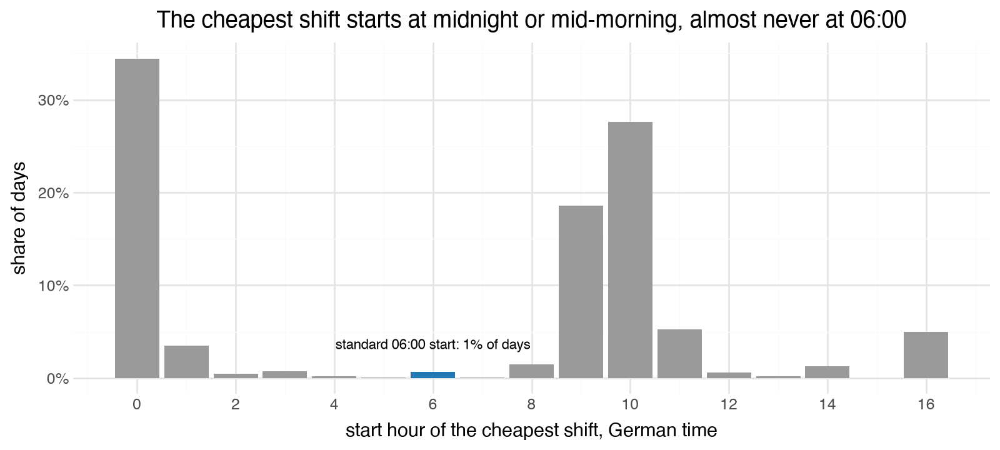
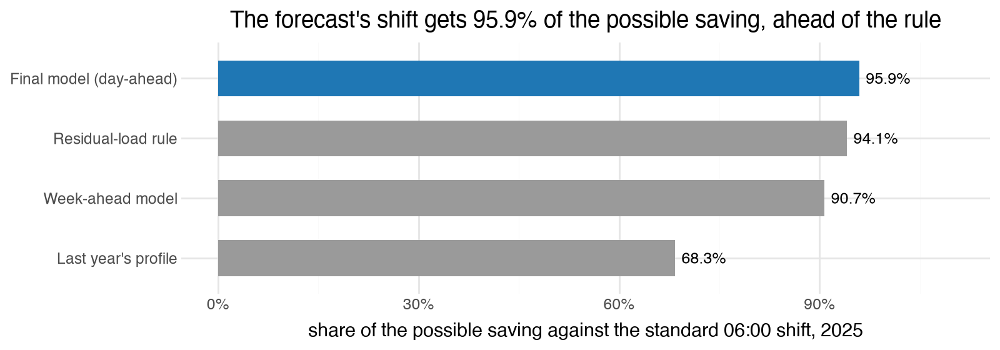
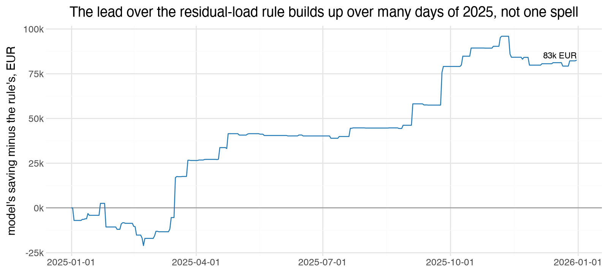
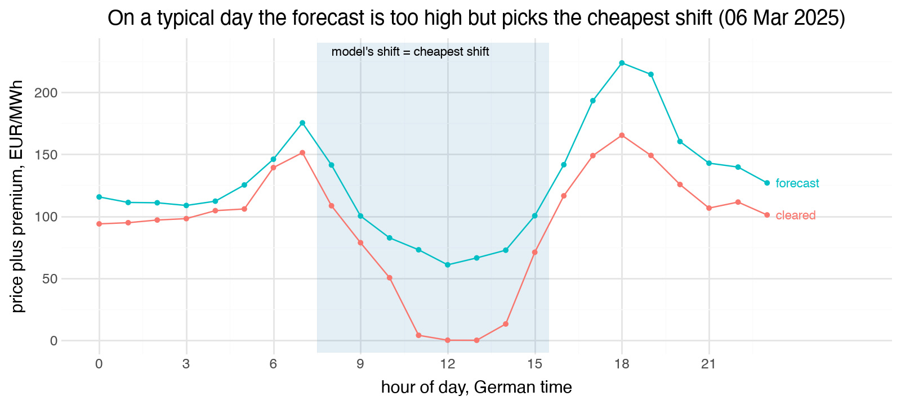
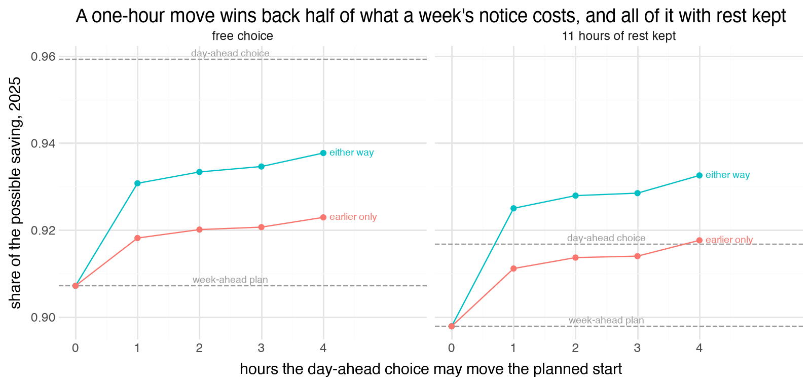

# When Should the Plant Run? Forecasting the German Day-Ahead Electricity Price to Schedule a Daily Shift

**DBA3803 Predictive Analytics for Business Applications, Group Project Report**

# 1. The business problem

A German industrial plant operates one 8-hour shift each day and consumes 500 MWh of electricity per shift, drawing 62.5 MW in each operating hour. The facility procures this power in the European day-ahead wholesale auction, which clears a separate price for every hour of the following day and closes at 12:00 CET on the day prior to delivery (ACER n.d.; Nord Pool 2025). Consequently, at 11:55 German time, five minutes before auction gate closure, the plant manager must select tomorrow's shift start time from 17 feasible options: any whole hour from 00:00 to 16:00, ensuring the entire 8-hour shift concludes within the delivery day. The cost of each operating hour equals the day-ahead clearing price plus an unsocial hours staff premium of 625 EUR per hour at night (22:00 to 06:00) and across all weekend hours. This premium represents an addition of roughly 25% on an operating crew costing 2,500 EUR per hour. Spread over the 62.5 MW hourly load, the staff premium adds 10 EUR/MWh. Night and weekend premiums do not stack.

Intraday power prices in Germany exhibit wide dispersion. Substantial solar generation suppresses midday prices, sometimes pushing clearing values below zero, while morning and evening demand peaks raise wholesale rates. A facility that adheres rigidly to a standard early shift, running from 06:00 to 14:00, pays whatever those designated hours clear at in the market. In 2025, selecting the cheapest 8-hour shift in hindsight would have saved 4.47 million EUR (specifically 4,469,477 EUR) relative to that standard early shift. Because plant management cannot observe tomorrow's cleared auction prices at 11:55, capturing this potential surplus requires a predictive model.

A non-predictive baseline exists: schedule the shift across the eight consecutive hours with the lowest forecast residual load (total system demand minus wind and solar generation), which isolates the net demand that must be covered by dispatchable thermal plants and cross-border imports. Although this physical heuristic performs well, it measures system stress purely in gigawatts. It cannot weigh the 10 EUR/MWh financial staff premium against prevailing hourly price spreads. A price forecasting model can.

We address three primary business questions:

1. Can an econometric and machine-learning price forecast generated at 11:55 select a cheaper operating shift than the physical residual-load heuristic?
2. What annual financial savings does this predictive capability generate for the plant?
3. Does this scheduling approach remain commercially viable when shifts must be committed a week in advance to establish workforce rosters, and when successive shifts must maintain an 11-hour statutory rest interval as mandated by German labour law (ArbZG §5)?

Resolving these questions requires historical hourly price series, exogenous transmission system operator forecasts, and neighbouring market data spanning diverse market conditions. We utilise seven years of public German power market data, training models on historical observations from 2019 to 2024 and testing performance out-of-sample on 2025.

In short: our final model, a two-stage Lasso linear regression followed by an XGBoost gradient boosted tree on calendar indicators, transmission system operator forecasts, and recent price lags, selects operating shifts that capture 95.9% of the theoretical maximum cost saving in 2025. This performance delivers 4.29 million EUR per year in cost reductions (electricity plus staff premium) against the standard early shift, providing an incremental gain of 83,000 EUR over the physical residual-load rule. This performance advantage held across both validation years and throughout an untouched reserve dataset covering the first nine months of 2026. Because transmission system operators publish no week-ahead wind or solar forecasts, a simple historical rule committing the previous week's cheapest 8-hour shift from Monday through Sunday establishes the weekly roster as effectively as a machine-learning model. The predictive model's primary value arises on the day before delivery, when renewable and load forecasts become available. When statutory rest constraints are enforced, the best operational policy we tested combines both approaches: establish a uniform weekly shift on Sunday using the historical rule and allow the 11:55 day-ahead forecast to adjust the daily start time by up to one hour either way. That hybrid schedule captures 4.13 million EUR per year in 2025, surpassing the 4.01 million EUR achieved by choosing each day freely the day before under the identical legal rest constraint.

# 2. Data, assumptions and what is missing

Our empirical analysis relies exclusively on public power market data. Table 1 outlines the coverage and dimensions of the datasets acquired for this study.

| Source | What it gives | Size |
|---|---|---|
| Energy-Charts API, Fraunhofer ISE: DE-LU day-ahead prices | The clearing price of every hour (every quarter hour from 1 Oct 2025) | 95,255 rows, 1 Jan 2019 to 11 Oct 2026 |
| Energy-Charts API: TSO day-ahead forecasts | Load, solar, onshore wind, offshore wind for every quarter hour of day D | 272,732 rows, same span |
| Energy-Charts API: neighbouring zones | Day-ahead prices of France, the Netherlands, Belgium, Austria, Switzerland, Czechia, Poland, Denmark (2 zones), southern Sweden and southern Norway | 95,255 rows, same span |

Table 1. Data sources (Fraunhofer ISE n.d.).

We executed four sequential preprocessing steps to assemble a unified hourly analytical table:

1. Time aggregation: All raw series were aggregated to hourly intervals using universal coordinated time (UTC). Forecast series were reported in 15-minute resolution across the entire sample period. Historical day-ahead prices transitioned to 15-minute contracts on 1 October 2025 when the European Single Day-Ahead Coupling (SDAC) launched 15-minute market time units (Nord Pool 2025). From 1 October 2025 onward, our hourly target price equals the arithmetic mean of the four constituent quarter-hour clearing prices.
2. Local calendar alignment: Calendar features were indexed to German local clock time to align with human socio-economic routines and domestic electricity demand cycles. This adjustment accounts for daylight saving transitions, producing 8 calendar days with 23 hours and 7 calendar days with 25 hours across the sample.
3. Imputation: No duplicate timestamps existed in any raw feed. Across the entire panel, only one series contained missing observations: 24 hours of Dutch day-ahead prices on 10 October 2026, which were forward-filled: each hour takes the last known Dutch price, from 23:00 on 9 October 2026.
4. Retention of market extremes: Historical price extremes were retained without winsorisation or truncation. This includes one hour in 2023 where the clearing price reached the market regulatory floor of -500 EUR/MWh. These values represent actual financial settlements paid or received by market participants. Finally, we derived residual load by subtracting solar, onshore wind, and offshore wind generation forecasts from the total load forecast.

The chronological data partition separates development from out-of-sample evaluation. Fold 1 trains on 2019 to 2022 (35,064 hours) and validates on 2023 (8,760 hours). Fold 2 trains on 2019 to 2023 (43,824 hours) and validates on 2024 (8,784 hours). The full development set, created after dropping the initial 30 days to initialise rolling lag structures, contains 51,888 hours (31 January 2019 to 31 December 2024). The 2025 calendar year (8,760 hours) serves as our primary out-of-sample test dataset, evaluated once by the final model. Observations from 1 January to 11 October 2026 (6,815 hours across 284 days) constitute an untouched reserve dataset, evaluated once at project completion to provide independent verification. Chronological splitting mirrors real-world deployment across fluctuating macroeconomic regimes, including the 2022 gas supply shock and subsequent post-crisis market normalisation. Exploratory data analysis examined 2019 to 2023, making validation Fold 1 slightly optimistic, whereas 2024 remained uninspected during exploration.

We acknowledge five analytical assumptions and data limitations, ranked by their operational materiality:

1. Forecast publication timelines: European transparency guidelines require transmission system operators (TSOs) to publish day-ahead total load forecasts no later than two hours prior to auction gate closure, ensuring availability by 10:00 CET and well before 11:55 (Commission Regulation (EU) No 543/2013, Art. 6(2)(b)). Conversely, day-ahead wind and solar generation forecasts are legally mandated only by 18:00 Brussels time on the day prior to delivery, six hours after gate closure (Commission Regulation (EU) No 543/2013, Art. 14(2)(d)). In real-world commercial operations, an industrial power buyer would procure morning weather and renewable production forecasts from private commercial vendors. Because commercial vendor archives were inaccessible for this academic project, public TSO generation forecasts serve as an operational proxy. Crucially, the physical residual-load heuristic relies on the identical forecast inputs, ensuring that publication timing differences do not confer an advantage to either scheduling method.
2. Quarter-hour contract settlement: Because the European power market adopted 15-minute trading contracts on 1 October 2025 (Nord Pool 2025), our target from that date onward is the hourly mean of four quarter-hour clearing prices rather than the price of a single hourly product.
3. Absence of fuel commodities and statutory holidays: The analytical table contains no natural gas, coal, or carbon allowance price indices. The predictive models must therefore deduce overall wholesale price levels exclusively from recent electricity price memory. Furthermore, German public holidays are classified as regular weekdays.
4. Price taker assumption: In the cheaper price hours of 2025, the empirical slope of power prices against residual load was 2.94 EUR/MWh per GW. The plant's additional demand of 62.5 MW would raise clearing prices by approximately 0.18 EUR/MWh. This price impact is under 1% of the 23.5 EUR/MWh unit cost saving achieved by the model's chosen shift relative to the standard early shift (59.8 EUR/MWh versus 83.3 EUR/MWh). An industrial consumer would require a demand of approximately 3.4 GW (roughly 6% of Germany's 2025 mean forecast load of 53.6 GW) to shift the market price by 10 EUR/MWh, the magnitude of the staff premium.
5. Operational simplifications: Each shift remains confined within a single calendar day (starts between 00:00 and 16:00), and unsocial hours staff premiums do not stack.

# 3. What decides the cheapest shift

Before constructing predictive algorithms, we analysed the structural determinants of optimal shift schedules and the financial returns generated by basic heuristics across the 2019 to 2023 training period.

Figure 1. Share of days on which the cheapest shift, premium included, starts at each hour, 2019 to 2023.

Across the historical training period, the cheapest 8-hour shift almost never commenced at 06:00 (Figure 1). In each individual year, the optimal start hour was midnight (00:00) on 30% to 39% of days, where deeply discounted nocturnal base prices more than compensate for the 10 EUR/MWh night premium. On 40% to 57% of days, the cheapest shift commenced at 09:00 or 10:00, spanning the midday solar generation depression. Across the five-year pooled training sample, the standard 06:00 shift was optimal on 1% of days (at most 1% in any single year). Running a rigid 06:00 shift forfeits cost savings almost every single day, and the operational decision concentrates on selecting between two distinct operating windows: low-demand night hours and midday solar dips.

The scheduling decision depends strictly on the relative price shape across the hours of a given day, not the absolute price level. Adding an identical price increment to every hour of a delivery day increases the operating cost of all candidate shifts by the identical amount, leaving the ranking of shifts and the manager's decision unchanged. Yet macroeconomic price variation in wholesale electricity markets predominantly reflects whole-day level shifts: in 2021 and 2022, over 80% of total hourly price variance was driven by entire days shifting up and down together. The within-day variance share was 0.418 in 2019, 0.367 in 2020, 0.175 in 2021, 0.194 in 2022, and 0.431 in 2023, while annual mean prices escalated from 30.5 EUR/MWh in 2020 to 235.4 EUR/MWh in 2022 due to the gas crisis, before receding to 95.2 EUR/MWh in 2023. A standard regression algorithm trained to minimise global point-forecast error across all hours expends most of its explanatory capacity tracking macro price levels, information that does not aid the shift scheduling decision. Consequently, forecasting models must be evaluated on the cost of the shifts they select.

Residual load governs the diurnal shape of electricity prices. Within each individual day, the correlation between hourly residual load and price ranged between 0.76 and 0.85 across training years, with a pooled correlation of 0.70 across 2019 to 2023. Individual fundamental components exhibited substantially weaker within-day correlations (solar had the strongest individual correlation at -0.288). However, the marginal price impact of an additional gigawatt of residual load shifted from 1.1 EUR/MWh per GW in 2019 to 7.1 EUR/MWh per GW in 2022, and settled at 3.1 EUR/MWh per GW in 2023, moving with the gas price. In the absence of direct fuel indices, models must infer the prevailing wholesale price baseline from recent price history. Autocorrelation at lag 24 (the same hour on the previous day) is 0.90, representing the strongest valid price lag, while autocorrelation at lag 168 (the same hour one week prior) is 0.83, capturing weekly structural patterns. Wholesale prices on Sundays averaged 27 EUR/MWh below their weekly mean (clearing cheaper than the weekly mean in 89% of weeks), while Saturdays averaged 15 EUR/MWh below the weekly mean.

Basic heuristic rules capture a substantial portion of potential savings. Selecting the eight consecutive hours with the lowest forecast residual load captured between 87% and 97% of the maximum potential saving across 2019 to 2023. Scheduling shifts based on yesterday's hourly price profile captured 52% to 71%, while replicating last year's average hourly profile recovered 26% to 54%. The residual-load rule misses the largest share of savings in calm market years such as 2019 and 2020. In those years, the 10 EUR/MWh staff premium is large relative to modest hourly price spreads, and a physical rule operating in gigawatts cannot price the trade-off. That performance gap, spanning 3% to 13% of the potential saving, represents the economic opportunity for an econometric price forecast.

Our forecasting framework therefore models hourly prices from forecast residual load, recent price lags, and calendar variables, and is evaluated directly on downstream shift selection.

# 4. Method

Because shift optimisation depends strictly on intraday price profiles rather than absolute price levels, forecasting models must be assessed on downstream decision loss rather than statistical prediction errors alone (Elmachtoub and Grigas 2022).

## 4.1 The decision metric

Each candidate method generates a 24-hour day-ahead price forecast for the target day, adds the 10 EUR/MWh staff premium to night and weekend hours, and identifies the 8-hour consecutive window with the lowest total forecast cost. The chosen shift is subsequently billed at actual realised day-ahead auction clearing prices. To compare performance across years with disparate price regimes, we compute the saving share metric:

$$\text{saving share} = \frac{\text{standard shift cost} - \text{picked shift cost}}{\text{standard shift cost} - \text{cheapest shift cost}}$$

Each cost component represents the annual volume-weighted average in EUR/MWh (clearing price plus applicable staff premium). A saving share of 100% denotes performance matching the hindsight optimum, whereas 0% denotes performance no better than the fixed 06:00 early shift. In 2023, for example, the standard shift cost an average of 97.4 EUR/MWh, the hindsight cheapest shift cost 74.5 EUR/MWh, and the shift chosen by the physical residual-load rule cost 76.2 EUR/MWh. The residual-load rule therefore captured $(97.4 - 76.2) / (97.4 - 74.5) = 93\%$ of the available saving (93.0% from the unrounded costs). We also compute total annual savings in EUR for a commercial plant consuming 500 MWh per day (62.5 MW across 8 hours over 365 days). Standard point-forecast metrics, Mean Absolute Error (MAE), Root Mean Squared Error (RMSE), and Mean Absolute Scaled Error (MASE) scaled by the naive lag-24 benchmark (Hyndman and Koehler 2006), are reported for academic completeness and serve strictly as secondary tie-breakers.

## 4.2 Three candidate methods

A purely linear model cannot address this scheduling problem because the marginal price response to residual load bends non-linearly with market conditions. During 2021, wholesale prices rose steeply once residual load exceeded approximately 52 GW. We evaluated three modelling frameworks:

- Lasso-then-XGBoost: A two-stage hybrid architecture. A Lasso regularised linear regression (Tibshirani 1996), which applies an L1 penalty to shrink regression coefficients and perform feature selection, models steady daily and weekly baselines. XGBoost (Chen and Guestrin 2016), a scalable gradient tree boosting system that constructs regression trees sequentially to fit the residual errors of preceding trees, then models non-linearities and scarcity bends. The final forecast is the sum of both model stages. The Lasso stage receives residual load and solar forecasts rather than collinear individual components.
- XGBoost alone: An isolated gradient boosted tree model omitting the linear Lasso stage, which isolates the specific contribution of the two-stage structure.
- LEAR (Lasso Estimated AutoRegressive): The open-access benchmark model proposed by Lago et al. (2021), comprising 24 individual Lasso models (one per delivery hour) trained on lagged prices and exogenous forecasts. While the published benchmark recalibrates daily, our implementation recalibrates once a year, like the other two candidates.

## 4.3 Model selection protocol and rule revision

Candidate configurations were evaluated across both validation folds (2023 and 2024). For any paired comparison between option A and option B, we compute the annual difference in saving share ($A - B$) for each validation year and its standard error, defined as the standard deviation of the two annual gaps divided by the square root of 2 ($SE = SD / \sqrt{2}$). Option A leads only if the mean difference exceeds its standard error, which with two validation years requires A to beat B in both years. With one degree of freedom this is a rough test, not a test of statistical significance. Taking paired gaps within each year removes shared macroeconomic shocks: the residual-load rule, LEAR, and Lasso-then-XGBoost all scored approximately 2 percentage points higher in 2024 than in 2023. Three hierarchical rules govern selection:

1. Between competing algorithmic methods, superior saving share wins; in the event of a tie, lower MAE wins; if still tied, the simpler method is selected.
2. Within a specific method, hyperparameter tuning selects the lowest MAE among configurations tied for the highest saving share.
3. Extended parameter searches supersede the baseline configuration only if they demonstrate a decisive win under Rule 1.

Following our initial project presentation, we refined this evaluation protocol. The presentation selected XGBoost alone under an earlier selection rule that compared the mean saving share margin against each model's cross-year standard deviation. That cross-year standard deviation primarily measured how significantly market conditions differed between 2023 and 2024, an external shock that shifted both models in tandem. We therefore replaced it with paired fold differences. Under paired evaluation, Lasso-then-XGBoost wins. On the 2025 test year, this revision yielded a saving share of 95.9% (compared to 96.4% for XGBoost alone, with an annual lead over the rule of 83,000 EUR versus 105,000 EUR), but delivered superior performance on the untouched 2026 reserve dataset (99.1% versus 98.7%, with an annual lead over the rule of 73,000 EUR versus 49,000 EUR and a 95% bootstrap interval of 20,000 to 157,000 EUR versus -11,000 to 141,000 EUR). Because this protocol change occurred after initial scoring of 2025, the 2026 reserve dataset, scored once with nothing changed after it, is the cleaner check.

# 5. Choosing the model on 2023 and 2024

We evaluated algorithmic architectures, feature representations, and hyperparameter grids across the 2023 and 2024 validation years in accordance with our selection rules.

## 5.1 Methods

| Method (default settings) | Saving share | 2023, 2024 | MAE (EUR/MWh) | MASE |
|---|---|---|---|---|
| Lasso-then-XGBoost | 95.6% | 94.7%, 96.6% | 17.5 | 0.636 |
| XGBoost alone | 95.4% | 95.6%, 95.1% | 18.9 | 0.686 |
| Residual-load rule | 94.1% | 93.0%, 95.2% | | |
| LEAR | 93.5% | 92.7%, 94.4% | 17.1 | 0.621 |
| Same hour yesterday | 73.7% | | 27.5 | 1.000 |
| Last year's profile | 55.3% | | | |

Table 2. Methods on the validation years, mean of 2023 and 2024.

LEAR achieved the lowest point-forecast error across candidate models (MAE of 17.1 EUR/MWh), yet it secured the lowest saving share (93.5%), trailing both tree-based methods in both validation years by 2.1 and 1.8 percentage points, and underperforming the physical residual-load rule (Table 2). Minimising point-forecast errors across all hours does not ensure accurate rank-ordering of candidate shifts, and ranking is what determines schedule selection. LEAR was therefore dropped. At default settings, the two tree-based methods tied (difference 0.3 percentage points, SE 1.2).

## 5.2 Feature groups

Feature ablation on Lasso-then-XGBoost revealed that recent price memory is indispensable: omitting recent price lags reduces saving share by 31.4 percentage points (SE 4.1). Introducing load and renewable generation forecasts contributes an additional 10.3 percentage points (SE 2.4) once price memory is established; calendar indicators paired with price memory achieve 85.5%, which increases to 95.8% upon incorporating fundamental forecasts. Recent prices establish the wholesale price level, while generation forecasts dictate intraday profile shape. Calendar variables produced an empirical tie (0.5 percentage points, SE 0.7) and were retained because this comparison was conducted after scoring 2025, avoiding ex-post model alterations. An interaction term between residual load and the 30-day mean price tied (0.4 percentage points, SE 0.8) and was dropped as the simpler option. Price spreads from 11 neighbouring bidding zones degraded schedule selection in both validation years (-0.6 percentage points, SE 0.3), despite reducing point forecast MAE from 19.1 to 17.5 EUR/MWh, and were excluded. The final feature set comprises 17 columns: 4 calendar indicators (hour of day, day of week, month, weekend indicator), 5 fundamental forecasts (day-ahead load, solar, onshore wind, offshore wind, and residual load), and 8 price memory lags (same hour 1, 2, and 7 days prior; yesterday's mean, minimum, and maximum; and 7-day and 30-day rolling daily means).

## 5.3 Settings

Both tree architectures were evaluated across a shared 24-point hyperparameter grid, with Lasso-then-XGBoost tested across three Lasso penalty values ($\alpha \in \{0.3, 1.0, 3.0\}$). At optimal configurations, Lasso-then-XGBoost achieved a 96.7% mean saving share compared to 95.7% for XGBoost alone, leading in both validation years (96.3% versus 95.5% in 2023; 97.1% versus 96.0% in 2024; margin 1.0 percentage point, SE 0.1). Subsequent random searches over 100 alternative parameter sets failed to improve upon these configurations under Rule 3. The final operational model specifies Lasso-then-XGBoost with a Lasso penalty of 3, 500 trees, maximum tree depth of 6, and a learning rate of 0.03. On cross-validation, it captured 96.7% of available savings, identified the cheapest shift on 74.7% of days, and recorded an MAE of 17.3 EUR/MWh (RMSE 27.9, MASE 0.628), maintaining a 2.7 percentage point lead over the residual-load rule in both validation years (SE 0.7).

## 5.4 Does the model make sense?

Model error concentrates during extreme price spikes. Across hours clearing above 200 EUR/MWh (241 hours in validation), the model recorded an MAE of 91.1 EUR/MWh and underpredicted prices by an average of 56.3 EUR/MWh, compared to an MAE of 16.1 EUR/MWh on ordinary hours between 0 and 200 EUR/MWh (16,545 hours). Daily forecast errors remained within ±40 EUR/MWh on 96% of days, but reached +110 and +180 EUR/MWh on 11 and 12 December 2024, and -245 EUR/MWh on 13 December 2024 during a windless cold spell. Because error magnitude scales with price level, we tested an inverse hyperbolic sine transformation, asinh(price), to compress extreme values. However, variance compression impaired schedule selection, reducing saving share from 96.7% to 94.5% (a deficit of 2.2 percentage points, SE 0.7, with MAE worsening to 18.2 EUR/MWh), because dampening extreme values compresses the inter-hour price spreads required for ranking. Untransformed prices were therefore maintained. Diurnally, the model slightly underpredicts evening peak hours (19:00 to 20:00) and night hours, by up to about 2 EUR/MWh on average, while overpredicting midday hours (09:00 to 16:00) by approximately 3 EUR/MWh.

# 6. Results on 2025

## 6.1 Performance on the 2025 test year and 2026 reserve

With all model specifications locked on the validation folds, the final Lasso-then-XGBoost model was refitted on the complete 2019 to 2024 development history and scored out-of-sample on the 2025 test year.

Figure 2. Share of the possible saving against the standard 06:00 shift, 2025.

| Method, 2025 | Saving share | Saving, EUR a year | Cheapest shift picked | MAE |
|---|---|---|---|---|
| Final model | 95.9% | 4,287,000 | 73.7% of days | 16.2 |
| Residual-load rule | 94.1% | 4,205,000 | 70.7% | |
| Last week's mean price at each hour | 89.1% | 3,982,000 | 52.0% | 26.8 |
| Same hour yesterday | 83.2% | 3,717,000 | 49.9% | 26.0 |
| Last year's profile | 68.3% | 3,055,000 | 32.9% | |
| Cheapest shift in hindsight | 100% | 4,469,000 | 100% | |

Table 3. The test year, 2025, for 500 MWh a day.

The predictive model outperforms the physical residual-load heuristic on the 2025 test dataset (Figure 2, Table 3). The final model captures 95.9% of the theoretical maximum saving compared to 94.1% for the physical rule, delivering 4,287,000 EUR in annual savings on electricity plus staff premium relative to the standard 06:00 schedule (averaging 59.84 EUR/MWh against 83.34 EUR/MWh). This represents an incremental gain of 83,000 EUR (specifically 82,645 EUR) over the residual-load rule. While the out-of-sample lead is narrower than the 2.7 percentage point margin observed in cross-validation, it remains positive. The model identifies the cheapest shift on 73.7% of days, compared to 70.7% for the rule. Choosing a shift dynamically using the residual-load rule captures 4.20 million EUR (4,205,000 EUR), which is roughly 50 times the incremental 83,000 EUR provided by the econometric forecast.

A simpler day-ahead pricing benchmark is to schedule shifts using each clock hour's mean clearing price over the preceding seven days. In 2025, this historical average achieves an 89.1% saving share (3.98 million EUR per year, or 3,982,000 EUR). Our final predictive model delivers approximately 305,000 EUR per year in additional savings over this benchmark. The predictive model generates this premium because it incorporates transmission system operator forecasts of tomorrow's load, wind, and solar generation, whereas trailing historical prices contain no information regarding tomorrow's weather conditions.

To assess whether this 83,000 EUR outperformance reflects stochastic sampling variation in 2025 weather regimes, we conducted a moving-block bootstrap with 10,000 resamples (Künsch 1989). Resampling blocks of 7 consecutive days preserves underlying weekly operational cycles and autocorrelation in weather regimes. The resulting 95% bootstrap confidence interval spans 3,700 to 181,000 EUR per year, with the final model failing to beat the heuristic rule in only 2.0% of iterations. Sensitivity checks across 1-day blocks (2,700 to 170,000 EUR, 2.1% loss rate) and 30-day blocks (550 to 198,000 EUR, 2.4% loss rate) corroborate that the model's advantage is statistically robust, although its exact magnitude carries uncertainty.

Figure 3. The final model's saving minus the residual-load rule's, added up from 1 January 2025.

Cumulative savings accumulate steadily across the calendar year rather than originating from an isolated market event (Figure 3). The forecasting model lagged the benchmark rule slightly through February, pulled ahead in March, maintained an advantage of approximately 40,000 EUR through the summer months, reached 80,000 EUR in September, and concluded the year at 83,000 EUR.

Figure 4. Forecast and cleared price plus premium on 6 March 2025, the 2025 weekday whose mean price is closest to the year's median day.

Figure 4 illustrates our core empirical finding on a representative business day (6 March 2025, the weekday with daily mean price closest to the median day of 2025). The forecast was 7 to 69 EUR/MWh too high across all 24 hours and underestimated the depth of the midday solar depression, yet its selected shift (08:00 to 16:00) matched the cheapest shift in hindsight. Because profile shape dictates schedule selection, shape accuracy compensates for point-forecast bias.

To provide independent verification following post-presentation protocol adjustments, the model was retrained on data through 2025 and evaluated once across the reserve period from 1 January to 11 October 2026 (284 days). The model achieved a 99.1% saving share against 97.8% for the residual-load rule, generating an annualised lead of 73,000 EUR (72,992 EUR) with an MAE of 23.3 EUR/MWh (MASE 0.740). A 7-day block bootstrap confirmed an incremental benefit between 20,000 and 157,000 EUR per year, with the model trailing the heuristic in under 0.05% of resamples.

## 6.2 Does the model's behaviour make business sense?

The model's operational behaviour reflects the physical and economic structure of the German wholesale power market. System residual load dictates how far demand reaches along the merit order, where available power generation plants are ranked from cheapest to dearest marginal operating cost. The marginal facility dispatched at that intersection establishes the market clearing price for each hour, determining the diurnal price shape. Because the variable generation cost of the marginal thermal plant depends predominantly on the price of natural gas, and our dataset excludes fuel commodity indices, recent electricity prices serve as an indispensable proxy for the prevailing fuel cost baseline. Feature ablation confirms this economic logic. Omitting price memory causes saving share to collapse by 31.4 percentage points (SE 4.1). Introducing transmission system operator load and renewable forecasts contributes an additional 10.3 percentage points (SE 2.4) once price memory is established. Without price memory, combining calendar indicators with fundamental forecasts achieves a saving share of only 64.4%, falling well behind calendar indicators alone (84.0%). The likely, though unproven, reason is that without an anchored price baseline, the model misinterprets minor dips in residual load as substantial monetary gains, erroneously committing the plant to pay the 10 EUR/MWh unsocial hours staff premium for nocturnal or weekend shifts.

Consistent with our decision-focused evaluation framework, model features were selected first on shift scheduling performance rather than point-forecast error. For instance, incorporating price spreads from 11 neighbouring bidding zones reduced point-forecast MAE from 19.1 to 17.5 EUR/MWh, yet degraded shift selection across both validation years (-0.6 percentage points, SE 0.3), leading us to discard them. Shift optimisation depends exclusively on the relative intraday price profile rather than the absolute price level. As illustrated by the representative operations of 6 March 2025 in Figure 4, the model selected the hindsight-optimal shift despite substantial point-forecast bias across all hours, because the intraday price profile was captured well enough to rank the shifts.

Forecast errors are largest during extreme market price spikes, representing our largest point inaccuracies rather than the majority of total error mass. Across validation hours clearing above 200 EUR/MWh (241 hours), the model recorded an MAE of 91.1 EUR/MWh, compared to an MAE of 16.1 EUR/MWh across normal hours between 0 and 200 EUR/MWh (16,545 hours). As detailed in Section 5.4, an inverse hyperbolic sine transformation, asinh(price), was evaluated to compress these extremes, but it impaired shift selection by dampening the hourly spreads needed to rank candidate shifts. We therefore retained untransformed prices and classified price spikes as an operational limitation.

Following our initial presentation, we revised three core aspects of our methodology where the original operational logic proved unsound:

First, we corrected the model selection protocol. The original rule compared mean margins against cross-year standard deviations, which predominantly captured macroeconomic divergence between 2023 and 2024 rather than algorithmic merit. Replacing this with paired annual differences (Section 4.3) changed our final specification from isolated XGBoost to Lasso-then-XGBoost.

Second, unconstrained daily optimisation violated the statutory 11-hour rest rule on 7.4% of days in 2025. Section 7.2 explicitly incorporates and prices this legal constraint.

Third, scheduling daily shifts at 11:55 affords the operating crew merely one day of notice. Section 7.1 resolves this by establishing a weekly roster on Sunday using a simple heuristic that matches model performance, while Section 7.3 allows the day-ahead forecast to adjust planned start times by up to one hour.

Finally, an inherent data constraint remains that data preprocessing cannot resolve: public wind and solar forecasts are legally due only by 18:00 on D-1, well after auction closure. Our operational findings necessarily assume the facility procures morning commercial forecasts of comparable fidelity, as outlined in Section 2.

# 7. Putting it into practice: notice and rest

Following our presentation, Dr Lim raised two practical constraints: factory personnel require shift rosters determined more than one day in advance, and consecutive shifts may leave too little rest between them. Dr Lim suggested evaluating a hybrid schedule: committing a week-ahead plan on Sunday and allowing minor schedule adjustments on the day ahead. This section evaluates each operational adaptation across the 2025 test dataset.

## 7.1 Fixing the week on Sunday

Industrial operations require advance workforce scheduling. We evaluated a week-ahead scheduling policy that commits all seven shifts for the upcoming week at 11:55 on the preceding Sunday. The model architecture, feature definitions, and hyperparameter settings remain identical to the final model, but inputs are strictly restricted to data available by Sunday at 11:55: calendar indices, prices up to and including all of Sunday (whose auction cleared on Saturday), and 7-day and 30-day rolling means up to that Sunday. TSOs publish no wind or solar forecast a week ahead, and the week-ahead load forecast they do publish (a daily maximum and minimum, every Friday; Commission Regulation (EU) No 543/2013, Art. 6(1)(c)) is not in our data source, so this week-ahead model operates entirely without meteorological fundamentals.

On the 2025 test year, the week-ahead model achieves a 90.7% saving share, generating 4,055,000 EUR in annual savings. Providing a full week of advance roster certainty costs approximately 233,000 EUR per year relative to dynamic day-ahead scheduling (4,287,000 EUR), while outperforming the static historical profile benchmark (68.3%, 3,055,000 EUR) by 1,000,000 EUR. On validation folds, the week-ahead model attained 86.1% (3.50 million EUR) versus 96.7% for day-ahead optimization (a gap of 438,000 EUR), closing 81% of the deficit against static profiles on 2025 and 74% on validation. Although its point-forecast accuracy is poorer than the persistence benchmark (MASE 1.03, MAE 26.6 EUR/MWh), the week-ahead model schedules effectively by capturing fixed calendar diurnal rhythms and prevailing wholesale price baselines.

Although commercial vendors offer multi-day wind and solar power forecasts for Germany extending up to ten days ahead (energy & meteo systems n.d.), public transmission system operators do not issue week-ahead renewable generation forecasts. Because our dataset contains no multi-day weather projections, the week-ahead predictive model operates without meteorological inputs and consequently observes little beyond the preceding week's settled prices.

We therefore evaluated a transparent heuristic alternative against the week-ahead model, designated the 'last-week rule'. At 11:55 on each Sunday, this rule calculates each clock hour's mean price over the seven days up to and including Sunday, adds the staff premium averaged across the week (10 EUR/MWh between 22:00 and 06:00, and 10 x 2/7 EUR/MWh in daytime hours, since only the two weekend days carry the premium by day), selects the cheapest 8-hour consecutive shift on that resulting profile, and assigns that identical start time from Monday through Sunday. Across the validation folds, the last-week rule achieved a mean saving share of 88.1% (87.8% in 2023 and 88.3% in 2024), whereas the week-ahead model attained 86.1% (82.8% in 2023 and 89.4% in 2024). The paired annual margin of the rule over the model (+5.0 percentage points in 2023 and -1.1 in 2024, SE 3.1) represents an empirical tie under our model selection protocol (Section 4.3). Because the heuristic rule generates no point forecasts and therefore has no MAE, the simpler method wins, and the rule is selected to establish the weekly baseline roster. We also examined eight rule variants across validation, including four-week historical lookbacks and separate weekday and weekend profiles, but none improved upon the baseline rule; accordingly, only the baseline last-week rule was evaluated on the 2025 test dataset.

On the 2025 test year, the last-week rule attained an 89.0% saving share (3.98 million EUR per year, or 3,979,530 EUR), compared to 90.7% (4.05 million EUR, or 4,055,000 EUR) for the week-ahead econometric model. A single test year cannot overturn a two-year validation decision, particularly as the rule's 5.0 percentage point lead in 2023 exceeds the model's 1.7 percentage point margin in 2025. Furthermore, committing a uniform shift time for the entire week provides substantial operational stability: the last-week rule alters start times only 10, 19, and 20 times per year across 2023, 2024, and 2025 respectively, compared to 101 to 127 start changes under the week-ahead model and 155 to 169 changes under daily selection. Because the rule maintains a single start time from Monday through Sunday, the statutory rest requirements evaluated in Section 7.2 are guaranteed to hold within every weekly roster.

The predictive model's true economic value emerges on the day before delivery, when forecasts of tomorrow's load, wind, and solar generation become available; a week in advance, no public wind or solar forecasts exist. This reveals a broader operational principle: not every component of an industrial decision problem requires a machine-learning model. Where a simple heuristic matches algorithmic performance, it offers substantial business advantages: it is straightforward to communicate to workforce staff and costs nothing to run.

## 7.2 Eleven hours of rest

Section 5(1) of the German Working Hours Act (Arbeitszeitgesetz, ArbZG) mandates an uninterrupted minimum rest period of 11 hours between consecutive shifts (ArbZG §5). For standard 8-hour shifts across consecutive calendar days, an incoming shift may begin at most 5 hours earlier than the start time of the previous day's shift. Unconstrained day-ahead optimization disregards this legal mandate. To model compliance, each algorithm greedily selects its cheapest forecast shift among start hours that guarantee 11 hours of rest following the locked prior-day shift, reflecting operational choices at 11:55 on D-1. The benchmark for 100% saving share is recomputed using dynamic programming to identify the global cost-minimising sequence of rest-compliant shifts across the entire year.

| Schedule, 2025 | Days that break the rule | Saving share, free choice | Saving share, rest kept | Change in saving, EUR a year |
|---|---|---|---|---|
| Final model (day-ahead) | 27 (7.4%) | 95.9% | 91.7% | -279,000 |
| Week-ahead schedule | 12 (3.3%) | 90.7% | 89.8% | -129,000 |
| Last-week rule, one start a week | 2 (0.5%) | 89.0% | 91.5% | +22,000 |
| Residual-load rule | 43 (11.8%) | 94.1% | 85.8% | -453,000 |
| Cheapest in hindsight | 26 (7.1%) | 100% | 100% | -97,000 |

Table 4. Rest between shifts, 2025.

Even the unconstrained hindsight optimum violates statutory rest mandates on 26 days (7.1% of the year), confirming that schedule conflicts reflect market volatility rather than algorithmic error (Table 4). Enforcing legal rest compliance reduces annual savings for the day-ahead forecasting model by 279,000 EUR (settling at 4,009,000 EUR, or 4.01 million EUR, with 91.7% saving share). However, it penalises the residual-load benchmark far more severely, reducing its savings by 453,000 EUR (settling at 85.8% saving share). Consequently, under mandatory statutory rest constraints, the forecasting model's economic advantage over the physical heuristic expands from 83,000 EUR to approximately 257,000 EUR per year. Greedy day-ahead scheduling cannot foresee that selecting a late-running shift today precludes access to a low-cost early-morning shift tomorrow, which explains why global dynamic programming loses only 97,000 EUR.

Because the last-week rule maintains an identical start time throughout each calendar week, it can violate statutory rest requirements only on Monday transitions, occurring when the incoming week's start time is scheduled more than 5 hours earlier than the previous week's operating shift. In 2025, such conflicts arose on only 2 days (0.5% of the year). Enforcing compliance by restricting the incoming week's start time to begin at most 5 hours earlier imposed zero financial penalty in 2025, increasing annual savings by 22,000 EUR (+22,000 EUR, reaching a 91.5% saving share against rest-constrained hindsight). On validation folds, enforcing rest altered the rule's annual savings by -69,000 EUR in 2023 and -25,000 EUR in 2024. Under mandatory statutory rest in 2025, the last-week rule delivers 4.00 million EUR (4,001,000 EUR, or specifically 4,001,426 EUR), effectively matching the 4.01 million EUR (4,009,000 EUR, or 4,008,643 EUR) captured by the day-ahead forecasting model, whilst providing workforce personnel with a full week of advance roster certainty rather than a single day.

## 7.3 Plan the week, adjust the day before

To reconcile workforce stability with dynamic price responsiveness, we evaluated Dr Lim's proposed hybrid architecture: establish the weekly schedule on Sunday at 11:55 using the week-ahead model, and subsequently permit the day-ahead forecasting model at 11:55 on D-1 to adjust the planned start hour within a restricted operational window of $W$ hours ($W \in \{0, 1, 2, 3, 4\}$). We examined both symmetric flexibility ($\pm W$ hours) and asymmetric advance-only flexibility (0 to $W$ hours earlier). Under statutory rest constraints, the initial Sunday schedule is solved with rest constraints enforced, and each day-ahead adjustment is restricted to start times that maintain 11 hours of rest after the actual prior day's operational shift; a compliant start time is guaranteed to exist within the permitted window.

Figure 5. Share of the possible saving against how far the 11:55 choice may move the Sunday plan, 2025, with the pure week-ahead plan and the pure day-ahead choice as dashed lines.

| Plan and reach | Saving share, free | EUR a year, free | Saving share, rest kept | EUR a year, rest kept | Days moved |
|---|---|---|---|---|---|
| Model's plan, no move | 90.7% | 4,055,000 | 89.8% | 3,926,000 | 0% |
| Model's plan, 1 hour either way | 93.1% | 4,160,000 | 92.5% | 4,045,000 | 35% |
| Model's plan, 2 hours either way | 93.3% | 4,172,000 | 92.8% | 4,057,000 | 35% |
| Model's plan, 4 hours either way | 93.8% | 4,191,000 | 93.3% | 4,078,000 | 36% |
| Model's plan, 1 hour earlier only | 91.8% | 4,104,000 | 91.1% | 3,984,000 | 13% |
| Model's plan, 4 hours earlier only | 92.3% | 4,125,000 | 91.8% | 4,012,000 | 13% |
| Last-week rule's plan, no move | 89.0% | 3,980,000 | 91.5% | 4,001,000 | 0% |
| Last-week rule's plan, 1 hour either way | 91.7% | 4,100,000 | 94.4% | 4,129,000 | 35% |
| Any start (day-ahead choice) | 95.9% | 4,287,000 | 91.7% | 4,009,000 | |

Table 5. Plan on Sunday, adjust at 11:55 the day before, 2025. Days moved: share of days whose final start differs from the plan, free choice. Model's plan = week-ahead model, rule's plan = last-week rule of 7.1.

Most economic gains are captured within the first hour of flexibility (Figure 5, Table 5). Under unconstrained scheduling, permitting an adjustment of one hour either way ($\pm 1$ hour) increases saving share from 90.7% to 93.1%, recovering 105,000 EUR of the 233,000 EUR penalty associated with advance scheduling (45% recovery) to achieve 4,160,000 EUR annually. A four-hour window captures 4,191,000 EUR (recovering 136,000 EUR, or 59%). Schedule start times shift on approximately 35% of days, with an average adjustment of 0.35 hours per day under the one-hour window. Restricting adjustments to earlier starts recovers approximately half as much (49,000 EUR at 1 hour and 70,000 EUR at 4 hours). On validation folds, symmetric adjustments recovered 74,000 EUR of a 438,000 EUR gap at 1 hour and 118,000 EUR at 4 hours.

When statutory rest constraints are enforced, the hybrid policy outperforms choosing each day freely the day before. The $\pm 1$ hour hybrid schedule delivers 4,045,000 EUR (4.04 million EUR, 92.5% saving share) and the $\pm 4$ hour schedule reaches 4,078,000 EUR (93.3%), whereas choosing each day the day before under the rest rule yields only 4,009,000 EUR (91.7%). On validation folds, the hybrid schedule similarly achieves 3.56 million EUR (1 hour) and 3.61 million EUR (4 hours), compared to 3.29 million EUR for pure day-ahead selection. The likely reason is the one given in Section 7.2: choosing one day at a time under the rest rule, a late shift today can rule out a cheap early shift tomorrow. The Sunday plan already keeps the rule, and restricting each daily adjustment to a small window around it keeps each day's choice close to a sequence that works. In an operating environment governed by German labour law, providing workforce roster certainty with one hour of daily adjustment flexibility imposes no economic penalty on the plant.

We applied the identical hybrid scheduling framework using the last-week rule of Section 7.1 to establish the baseline Sunday plan, evaluating adjustment reaches of 0 and 1 hour either way. Following our evaluation protocol, two methodological decisions were locked prior to inspecting any results, governed by paired validation differences. First, daily adjustment flexibility is retained only if adjusting the rule's plan by up to one hour outperforms the unadjusted rule plan. On validation folds, permitting a 1-hour adjustment yielded an improvement of +2.0 percentage points under unconstrained scheduling (SE 0.9) and +2.7 percentage points with statutory rest enforced (SE 0.7), leading in both validation years in each case; the daily adjustment mechanism was therefore retained. Second, the week-ahead model's plan supersedes the last-week rule's plan only if it outperforms it on validation. Under unconstrained scheduling, the rule's plan exceeded the model's plan by +2.2 percentage points, but with SE 2.4 this constituted an empirical tie, selecting the simpler rule. With statutory rest enforced, the rule's plan outperformed the model's plan by +2.2 percentage points (SE 0.0), leading across both validation years; the last-week rule's plan was consequently locked as our primary operational baseline.

Our recommended operational policy is therefore to fix the weekly shift on Sunday via the last-week rule and permit the day-ahead forecasting model at 11:55 on D-1 to adjust the daily start time by up to one hour either way. Under mandatory statutory rest in 2025, this hybrid schedule captures 4.13 million EUR per year (specifically 4,129,000 EUR, or 94.4% of the rest-compliant hindsight optimum). This represents an incremental gain of 128,000 EUR over the static rule plan alone (4,001,000 EUR), 85,000 EUR over the week-ahead model's plan with the identical 1-hour adjustment (4,045,000 EUR, or 4.04 million EUR), and 121,000 EUR over selecting shifts freely each day the day before under the same statutory rest constraint (4,009,000 EUR, or 4.01 million EUR).

Under unconstrained scheduling in 2025, combining the week-ahead model's plan with a 1-hour daily adjustment attained 4.16 million EUR (4,160,000 EUR) compared to 4.10 million EUR (4,100,000 EUR) for the rule's plan. However, unconstrained scheduling repeatedly breaches statutory rest mandates, and the two baseline planning methods tied on validation. When operating under statutory rest requirements, anchoring shift schedules to the last-week rule and fine-tuning daily start times with the day-ahead forecast gives the highest annual cost saving of the schedules we tested while preserving workforce stability.

# 8. Recommendations

1. Schedule shifts dynamically every day rather than operating a static 06:00 schedule. The baseline residual-load heuristic captures 4,205,000 EUR (4.20 million EUR) in annual savings relative to standard operations on 2025, demonstrating that operational flexibility constitutes the dominant source of economic value.
2. Establish weekly rosters on Sunday using the last-week rule and allow the 11:55 day-ahead forecast to adjust start times by up to one hour either way, preserving 11 hours of statutory rest. In the absence of public week-ahead wind and solar forecasts, the simple historical rule matches an econometric model while maintaining a single uniform start time across the week. This operating policy provides factory personnel with one week of advance roster notice, satisfies the statutory 11-hour rest rule, and generated 4.13 million EUR in savings in 2025. This performance outperforms choosing shifts freely each day under the identical rest constraint (4.01 million EUR) and delivers an incremental 128,000 EUR per year over the unadjusted weekly rule plan alone. The predictive model's operational role is strictly focused on the day before delivery, where fundamental forecasts are available to fine-tune shift timing.
3. Deploy the predictive price model rather than the residual-load heuristic for daily shift scheduling. The predictive model delivers an additional 83,000 EUR per year under unconstrained conditions and an additional 257,000 EUR per year under statutory rest constraints, because it prices the 10 EUR/MWh staff premium directly in euros against market spreads.
4. Procure commercial morning wind and solar forecasts available prior to 12:00. Public TSO wind and solar forecasts are due only by 18:00, after auction gate closure; realising the demonstrated predictive savings requires commercial forecasts delivered on the morning of auction closure.

# 9. Limitations

1. Forecast publication timeline: Transmission system operator wind and solar generation forecasts in our dataset are legally due only by 18:00 on D-1, six hours after the day-ahead auction closes at 12:00 (Commission Regulation (EU) No 543/2013, Art. 14(2)(d)). Only the total load forecast is required to be published prior to auction gate closure (Art. 6(2)(b)). Consequently, all empirical findings in this study, including those of the physical residual-load heuristic, assume the plant procures commercial forecasts of comparable quality on the morning of D-1, before 12:00. A valuable follow-up study should rerun and validate the models using an archived commercial vendor forecast feed.
2. Moderate evaluation window and uncertain margin of lead: The model's outperformance over the residual-load rule relies on two validation years, one formal test year, and a nine-month reserve period. Although block bootstrap simulations confirm the lead is statistically significant in 2025, the 95% confidence interval spans 3,700 to 181,000 EUR per year. Longer evaluation periods with rolling daily refitting would narrow this range.
3. Prediction errors during extreme price spikes: The model underpredicts hours clearing above 200 EUR/MWh by an average of 56.3 EUR/MWh, with errors reaching 245 EUR/MWh during windless winter spells. Future work should incorporate scarcity features, such as reserve margins relative to available generation capacity, or dedicated extreme-value models.
4. Simplified scheduling assumptions: Shifts are restricted to start between 00:00 and 16:00 within a single calendar day, staff premiums do not stack, and the plant operates as a price taker. Allowing shifts to cross midnight would expand the set of selectable low-cost night hours.
5. Absence of fuel commodities and holiday calendars: Wholesale price levels are inferred solely from historical electricity price memory. Integrating a natural gas price series and an explicit calendar of public holidays represents the most direct opportunity to improve price level calibration and holiday profile shape.
6. Post-test protocol adjustments: The transition to paired fold differences and the decision to retain calendar features occurred after scoring the 2025 test dataset. The 2026 reserve dataset served as an independent, untouched verification of these decisions, corroborating model performance.
7. Annual recalibration of the LEAR benchmark: The implemented LEAR benchmark was recalibrated once a year to match computational baselines across methods, whereas the published literature specifies daily recalibration. This implementation choice likely understates the competitive performance of the linear benchmark.
8. Absence of week-ahead renewable forecasts: The week-ahead forecasting model operated without meteorological inputs because public transmission system operators do not issue wind and solar generation projections at a multi-day horizon. This lack of weather fundamentals most likely explains why a simple historical rule was able to match the predictive model's performance on a weekly horizon. Commercial vendors offer wind and solar power forecasts for European markets, including Germany, with horizons extending up to ten days (energy & meteo systems n.d.). A worthwhile follow-up study would retest the week-ahead predictive model incorporating such commercial forecasts, which represent the exogenous input most likely to allow an econometric model to outperform the historical rule a week in advance.

# References

ACER (n.d.) REMIT reporting guidance, question 2.1.29. Available at: https://www.acer.europa.eu/question-2129-data-field-30

Arbeitszeitgesetz (ArbZG), section 5(1) Ruhezeit. Available at: https://www.gesetze-im-internet.de/arbzg/__5.html

Chen, T. and Guestrin, C. (2016) 'XGBoost: A scalable tree boosting system', Proceedings of the 22nd ACM SIGKDD International Conference on Knowledge Discovery and Data Mining, pp. 785-794. https://doi.org/10.1145/2939672.2939785

Commission Regulation (EU) No 543/2013 of 14 June 2013 on submission and publication of data in electricity markets, Articles 6(2)(b) and 14(2)(d). Available at: https://eur-lex.europa.eu/eli/reg/2013/543

Elmachtoub, A. N. and Grigas, P. (2022) 'Smart "predict, then optimize"', Management Science, 68(1), pp. 9-26. https://doi.org/10.1287/mnsc.2020.3922

energy & meteo systems (n.d.) Market forecasts for wind and solar power in Europe. Available at: https://www.emsys-renewables.com/products/power_forecasts/market-forecasts-wind-solar.php

Fraunhofer ISE (n.d.) Energy-Charts API. Available at: https://api.energy-charts.info

Hyndman, R. J. and Koehler, A. B. (2006) 'Another look at measures of forecast accuracy', International Journal of Forecasting, 22(4), pp. 679-688. https://doi.org/10.1016/j.ijforecast.2006.03.001

Künsch, H. R. (1989) 'The jackknife and the bootstrap for general stationary observations', The Annals of Statistics, 17(3), pp. 1217-1241. https://doi.org/10.1214/aos/1176347265

Lago, J., Marcjasz, G., De Schutter, B. and Weron, R. (2021) 'Forecasting day-ahead electricity prices: A review of state-of-the-art algorithms, best practices and an open-access benchmark', Applied Energy, 293, 116983. https://doi.org/10.1016/j.apenergy.2021.116983

Nord Pool (2025) SDAC 15-minute MTU go-live. Available at: https://support.nordpoolgroup.com/support/solutions/articles/8000121859-about-sdac-15-minute-member-test

Tibshirani, R. (1996) 'Regression shrinkage and selection via the lasso', Journal of the Royal Statistical Society: Series B (Methodological), 58(1), pp. 267-288. https://doi.org/10.1111/j.2517-6161.1996.tb02080.x

