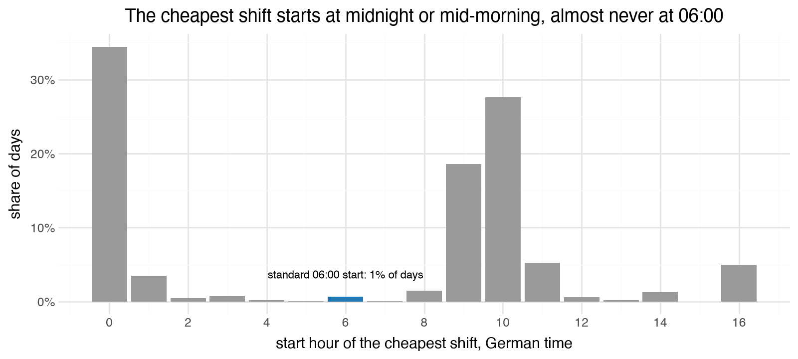
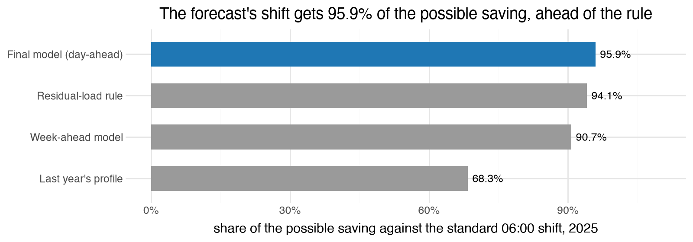
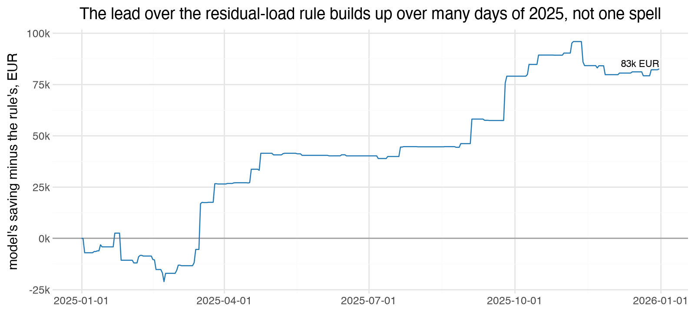
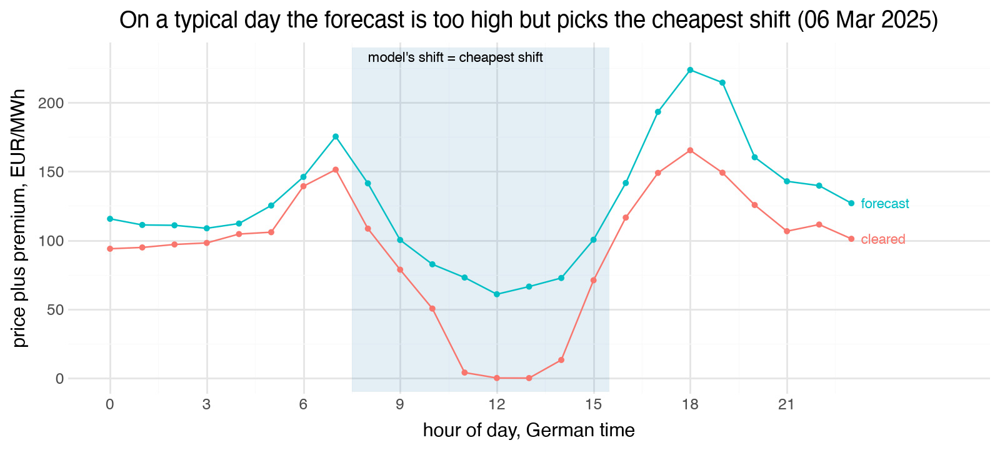
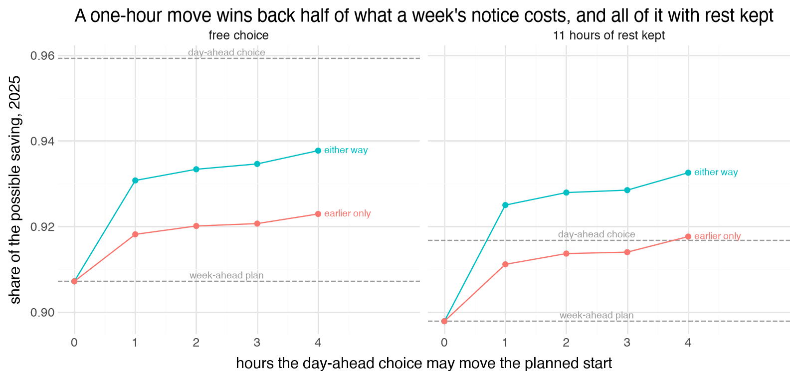

# 1. The business problem

A German industrial plant runs one 8-hour shift a day and uses 500 MWh of electricity per shift, 62.5 MW in each hour. It buys this power in the European day-ahead auction, which sets a separate price for every hour of the next day and closes at 12:00 CET the day before delivery (ACER n.d.; Nord Pool 2025). So every day at 11:55, five minutes before the auction closes, the plant has to choose when tomorrow's shift starts. It has 17 options, any whole hour from 00:00 to 16:00, so that the shift ends within the day. Each hour of the shift costs its day-ahead price plus a staff premium of 625 EUR an hour at night (22:00 to 06:00) and in every weekend hour, about 25% on a crew costing 2,500 EUR an hour. Spread over 62.5 MWh, the premium adds 10 EUR/MWh. Night and weekend premiums do not stack.

Prices within a German day are far from flat. Solar power pushes the midday price down, sometimes below zero, and demand lifts it in the morning and evening. A plant that always runs the standard early shift, 06:00 to 14:00, pays whatever those hours cost. In 2025, the cheapest shift in hindsight would have saved 4.47 million EUR against that standard shift. The plant cannot see tomorrow's prices at 11:55, so to capture this saving it needs a forecast.

A simple rule needs no price model at all: run the shift in the eight hours with the lowest forecast residual load (demand minus wind and solar), the demand that coal, gas and imports have to cover. The rule works well, but it measures hours in gigawatts, so it cannot weigh the 10 EUR/MWh premium against the price gaps between hours. A price forecast can.

We answer three questions:

1. Can a price forecast made at 11:55 pick a cheaper shift than the residual-load rule?
2. How much is that worth to the plant in a year?
3. Does it still pay when shifts must be fixed a week ahead, as a staff roster needs, and when staff must get 11 hours of rest between shifts, as German law requires (ArbZG §5)?

Answering them needs hourly prices, the forecasts the market sees, and enough years to cover both calm and crisis markets. We use seven years of public German data, build the forecast on 2019 to 2024 and test it once on 2025.

**In short:** our final model, a Lasso regression followed by XGBoost on calendar, load and renewable forecasts and recent prices, picks shifts that capture 95.9% of the possible saving in 2025. That is 4.29 million EUR a year against the standard shift, 83,000 EUR more than the residual-load rule, and the lead held in both validation years and in the first nine months of 2026. A week ahead there is no public wind or solar forecast, and there a simple rule sets the week as well as a model: rerun the shift that was cheapest on last week's prices, the same start from Monday to Sunday. The forecasting model earns its keep the day before, when tomorrow's load, wind and solar forecasts are out. Once the legal rest is kept, the best plan combines the two: the rule fixes each week's shift on Sunday, and the 11:55 forecast may move each start by up to one hour. That saves 4.13 million EUR a year on 2025, more than choosing each day freely under the same rest rule (4.01 million).

# 2. Data, assumptions and what is missing

Everything that follows rests on public data, so first what that data covers and what it leaves out (Table 1).

| Source | What it gives | Size |
|---------------------------------------|---------------------------------------|---------------------------------|
| Energy-Charts API, Fraunhofer ISE: DE-LU day-ahead prices | the clearing price of every hour (every quarter hour from 1 Oct 2025) | 95,255 rows, 1 Jan 2019 to 11 Oct 2026 |
| Energy-Charts API: TSO day-ahead forecasts | load, solar, onshore wind, offshore wind for every quarter hour of day D | 272,732 rows, same span |
| Energy-Charts API: neighbouring zones | day-ahead prices of France, the Netherlands, Belgium, Austria, Switzerland, Czechia, Poland, Denmark (2 zones), southern Sweden and southern Norway | 95,255 rows, same span |

Table 1. Data sources (Fraunhofer ISE n.d.).

Four steps turned the files into one hourly table:

1. Every file is averaged to UTC hours. The forecasts were quarter-hourly from the start, and the prices turned quarter-hourly on 1 October 2025, when the European day-ahead market moved to 15-minute products (Nord Pool 2025). From then on, our target is the hourly mean of the four quarter-hour prices.
2. Calendar columns are set in German local time, because demand follows the local clock. Clock changes leave 8 days with 23 hours and 7 with 25.
3. No file has duplicate timestamps. The only missing values, 24 hours of Dutch prices on 10 October 2026, are filled with the last known Dutch price, from 23:00 on 9 October.
4. Every extreme stays in, including one hour in 2023 at the auction floor of -500 EUR/MWh, because these are real prices the plant would have paid or been paid.

We also build residual load as the load forecast minus the solar, onshore wind and offshore wind forecasts.

The split follows time. Fold 1 trains on 2019 to 2022 and validates on 2023; fold 2 trains on 2019 to 2023 and validates on 2024. So every choice is tested both in the first year after the gas crisis and in a calm year. After dropping the first 30 days, which lack a full price history, the development data runs from 31 January 2019 to 31 December 2024 (51,888 hours). 2025 (8,760 hours) is the test year, scored once by the final model. 1 January to 11 October 2026 (284 days) is a reserve, scored once at the end as a bonus check. Exploration used 2019 to 2023, which makes fold 1 slightly optimistic; 2024 was never explored.

The gaps in the data and our assumptions, ranked by how much they could move the results:

1. **Forecast timing.** EU rules require TSOs to publish the day-ahead load forecast at least two hours before the auction closes, so it is out by 10:00. The day-ahead wind and solar forecasts are only due by 18:00 the day before delivery, six hours after the auction closes (Commission Regulation (EU) No 543/2013, Art. 6(2)(b) and 14(2)(d)). So the wind, solar and residual-load inputs we use would not be public at 11:55. A real buyer would buy a commercial forecast made the same morning from the same weather models. We have no access to those, so the TSO forecast stands in for one. The residual-load rule uses the same forecasts, so the timing does not favour either way of choosing the shift.
2. **Quarter-hour prices.** From 1 October 2025 our target is the mean of four quarter-hour prices, not the price of a product that cleared as one hour.
3. **No fuel price and no holidays.** The data has no gas, coal or carbon price, so the models have to read the price level from recent electricity prices. Public holidays look like ordinary weekdays.
4. **The plant is a price taker.** In 2025's cheaper hours, each extra GW of residual load raised the price by about 2.94 EUR/MWh, so the plant's 62.5 MW raises its own price by about 0.18 EUR/MWh. That is under 1% of the 23.5 EUR/MWh its chosen shift saves against the standard one (59.8 against 83.3 EUR/MWh). A buyer would need about 3.4 GW, 6% of Germany's mean forecast load of 53.6 GW in 2025, to move the price by the size of the premium.
5. **A simplified decision.** A shift stays within one day, though a real one can cross midnight, and the night and weekend premiums do not stack.

# 3. What decides the cheapest shift

Before building a model, we looked at what moves the cheapest shift and how much simple rules already get, using 2019 to 2023.

{width=72%}

Figure 1. Share of days on which the cheapest shift, premium included, starts at each hour, 2019 to 2023.

The cheapest shift almost never starts at 06:00 (Figure 1). In each year it started at midnight on 30% to 39% of days, when low night prices outweigh the night premium, and at 09:00 or 10:00 on 40% to 57% of days, over the midday solar dip. The standard shift was the cheapest on about 1% of days. A fixed early shift therefore leaves money on the table almost every day, and the real choice is between two very different parts of the day: the night and the middle of the day.

Only the shape of the day matters to that choice. Adding the same amount to every hour of a day makes every shift more expensive by the same amount, so the ranking of shifts, and the plant's decision, stay the same. Yet most price movement is exactly that kind of whole-day shift. The share of hourly price variance that comes from differences within the day was 0.42 in 2019, 0.37 in 2020, 0.18 in 2021, 0.19 in 2022 and 0.43 in 2023, so in 2021 and 2022 over 80% came from whole days moving up and down. Over the same years the yearly mean price rose from 30.5 EUR/MWh in 2020 to 235.4 in 2022, almost 8 times as high, and was still 95.2 in 2023. A model that minimises its error over all hours spends most of its effort on the level, which the decision never uses. So we judge every model by the cost of the shift it picks.

Residual load sets the shape. Within each day, the hours with high residual load are the expensive ones: the correlation between residual load and price within the day was 0.76 to 0.85 in each year and 0.70 over 2019 to 2023 pooled, against at most 0.29 for any single forecast (solar). But the price each extra GW adds moved from 1.1 EUR/MWh in 2019 to 7.1 in 2022 and 3.1 in 2023, with the gas price. The data has no gas price, so a model has to read the level from recent prices. The price at the same hour the day before is the strongest legal lag (correlation 0.90), and the same hour a week earlier (0.83) catches the weekly cycle. Sundays sit 27 EUR/MWh below their week's mean, and below it in 89% of weeks; Saturdays sit 15 below.

Simple rules already get most of the saving. Picking the eight hours with the lowest forecast residual load got 87% to 97% of the possible saving in each year from 2019 to 2023. Yesterday's prices got 52% to 71%, and last year's average price for each hour 26% to 54%. The residual-load rule misses most in the calm years 2019 and 2020. There the 10 EUR/MWh premium is large next to the price gaps between hours, and a rule that works in gigawatts cannot price that trade-off. That gap, 3% to 13% of the saving, is the room a price forecast has.

So the method forecasts prices from residual load, recent prices and the calendar, and is judged by the shift it picks.

# 4. Method

Section 3 showed that the choice uses only the shape of the day, so a forecast is judged by the cost of the decision it leads to, not by its price error alone (Elmachtoub and Grigas 2022).

## 4.1 The decision metric

Each method forecasts the 24 hourly prices of the next day, adds the 10 EUR/MWh premium to night and weekend hours, and picks the 8 consecutive hours with the lowest total. The shift is then paid at the real cleared price. To compare years with very different price levels, we use the saving share:

$$\text{saving share} = \frac{\text{standard shift cost} - \text{picked shift cost}}{\text{standard shift cost} - \text{cheapest shift cost}}$$

Each cost is the year's average EUR/MWh of price plus premium over the shifts in question. 100% means the method always found the cheapest shift; 0% means it did no better than the standard shift. In 2023, for example, the standard shift cost 97.4 EUR/MWh on average, the cheapest shift 74.5 and the residual-load rule's pick 76.2, so the rule got (97.4 - 76.2) / (97.4 - 74.5) = 93% of the possible saving. We also give the saving in EUR a year for 500 MWh a day. Mean absolute error (MAE), root mean squared error (RMSE) and the mean absolute scaled error (MASE), the MAE divided by that of the price at the same hour the day before (Hyndman and Koehler 2006), are reported for the course and only break ties.

## 4.2 Three candidate methods

A linear model alone cannot do this job, because the price each GW of residual load adds bends with the price level; in 2021 the price rose steeply once residual load passed about 52 GW. We compared three methods:

- **Lasso-then-XGBoost.** A Lasso (Tibshirani 1996), a linear regression whose penalty shrinks some coefficients and sets others to zero, fits the steady daily and weekly pattern. XGBoost (Chen and Guestrin 2016), which adds regression trees one at a time, each fitted to what the trees before it got wrong, then fits what the Lasso missed, such as the bend. The forecast is the sum of the two. The Lasso sees residual load and solar instead of all five forecasts, since residual load is an exact combination of the other four.
- **XGBoost alone**, the same method without the Lasso stage, which shows whether the Lasso stage helps.
- **LEAR** (Lasso Estimated AutoRegressive), the open benchmark of Lago et al. (2021): 24 separate Lasso models, one per delivery hour, on lagged prices and the forecasts. We refit it once a year, like the other two; the published version refits daily, which would probably help it.

## 4.3 How each choice is made

Every choice compares two options, A and B, on both validation years. For each year we take the gap in saving share, A minus B, and its standard error, the standard deviation of the two yearly gaps divided by √2. A leads only if the mean gap is larger than its standard error, which with two years means A beats B in both. With one degree of freedom this is a rough test, not a test of statistical significance. Taking the gap within each year cancels what the two years share: the residual-load rule, LEAR and Lasso-then-XGBoost all score about 2 points higher in 2024 than in 2023. Three rules, fixed before each comparison, settle every choice:

1. Between two methods, the one that leads on saving share wins; on a tie, the one that leads on MAE; if both tie, the simpler one.
2. Within one method, the best setting is the one with the lowest MAE among the settings that tie with the top setting on saving share.
3. A wider search only replaces a chosen setting if its best wins under rule 1.

This rule changed after our presentation. The presentation chose XGBoost alone under an earlier rule that compared the gap in mean saving share with each model's spread across the two years. That spread mostly measured how different 2023 and 2024 were, which moves both models the same way, so we replaced it with the paired gap. Under the paired gap, Lasso-then-XGBoost wins. The change cost a little on the test year (95.9% against XGBoost alone's 96.4% in 2025, and an 83,000 against a 105,000 EUR lead over the rule) and gained on the reserve (99.1% against 98.7%, a 73,000 against a 49,000 EUR lead, with a 95% bootstrap interval of 20,000 to 157,000 EUR instead of -11,000 to 141,000). Because the change came after 2025 had been scored, the 2026 reserve, scored once with nothing changed after it, is the cleaner check.

# 5. Choosing the model on 2023 and 2024

We compared the methods first, then the feature groups, then the settings, each on both validation years under the rules above.

## 5.1 Methods

| Method (default settings) | Saving share | 2023, 2024 | MAE (EUR/MWh) | MASE |
|-----------------------------------------|--------------------|--------------------|---------------------|--------|
| Lasso-then-XGBoost | 95.6% | 94.7%, 96.6% | 17.5 | 0.636 |
| XGBoost alone | 95.4% | 95.6%, 95.1% | 18.9 | 0.686 |
| Residual-load rule | 94.1% | 93.0%, 95.2% | | |
| LEAR | 93.5% | 92.7%, 94.4% | 17.1 | 0.621 |
| Same hour yesterday | 73.7% | | 27.5 | 1.000 |
| Last year's profile | 55.3% | | | |

Table 2. Methods on the validation years, mean of 2023 and 2024.

LEAR prices the hours best but gets the smallest share of the saving (Table 2). Its MAE of 17.1 EUR/MWh is the lowest of the three methods, yet both tree methods beat it in both years, by 2.1 and 1.8 points, and so does the residual-load rule. Pricing each hour well is not the same as ranking the hours well, and the ranking is what picks the shift. LEAR was not taken further. At default settings the two tree methods tie (a gap of 0.3 points, SE 1.2).

## 5.2 Feature groups

Each feature group was tested on Lasso-then-XGBoost by leaving it out of, or adding it to, the set of the others. Recent prices matter most: without them the saving share falls by 31.4 points (SE 4.1). The load and renewable forecasts add 10.3 points (SE 2.4), but only once recent prices are in: calendar with recent prices reaches 85.5%, and adding the forecasts lifts it to 95.8%. Recent prices give the level the premium is weighed against, and the forecasts give the shape of the day. Calendar tied (0.5 points, SE 0.7) and stays, because this comparison ran after 2025 had been scored, and removing it then would have changed the final model with no untouched year left to test it on. A column of residual load times the 30-day mean price tied (0.4 points, SE 0.8) and was dropped as the simpler option. The price gaps to the 11 neighbouring zones lowered the saving share in both years (-0.6 points, SE 0.3), even though they cut MAE from 19.1 to 17.5 EUR/MWh, so they were dropped too. The final model has 17 columns: 4 calendar columns (hour, weekday, month, weekend flag), the 5 forecasts (load, solar, onshore wind, offshore wind, residual load) and 8 recent-price columns (the same hour 1, 2 and 7 days earlier; yesterday's mean, minimum and maximum; and the 7-day and 30-day mean daily price).

## 5.3 Settings

Both tree methods then got the same grid of 24 tree settings, and Lasso-then-XGBoost three Lasso penalties (0.3, 1 and 3) on each. At their best, Lasso-then-XGBoost gets 96.7% and XGBoost alone 95.7%, and the two-stage model is ahead in both years (96.3% against 95.5% in 2023, 97.1% against 96.0% in 2024; a gap of 1.0 point, SE 0.1). A random search of 100 more settings for each method found nothing that replaced these under rule 3. The final model is Lasso-then-XGBoost with a Lasso penalty of 3 and 500 trees, 6 levels deep, at a learning rate of 0.03. On the validation years it gets 96.7% of the possible saving, picks the cheapest shift on 74.7% of days and has an MAE of 17.3 EUR/MWh (RMSE 27.9, MASE 0.628). It leads the residual-load rule by 2.7 points (SE 0.7), ahead in both years.

## 5.4 Where the model is weak

The model is weakest where prices spike. On the 241 validation hours above 200 EUR/MWh it misses by 91.1 EUR/MWh on average and predicts 56.3 too low, against an MAE of 16.1 on the 16,545 ordinary hours between 0 and 200. Daily errors stay within ±40 EUR/MWh on 96% of days. The worst came in a windless cold spell in December 2024: +110 and +180 EUR/MWh on 11 and 12 December and -245 on 13 December. Since the errors grow with the price, we tried forecasting asinh(price), which compresses large prices. That made the decision worse, 94.5% against 96.7% (a gap of 2.2 points, SE 0.7, with MAE rising to 18.2), because it also compresses the price gaps between hours that pick the shift. So the model forecasts the price as it is. By hour, it predicts the evening peak (19:00 to 20:00) and the night up to about 2 EUR/MWh too low on average, and 09:00 to 16:00 about 3 EUR/MWh too high.

# 6. Results

With every choice made on the validation years, the final model was refitted on 2019 to 2024 and scored once on 2025, a year neither the model nor the exploration had seen. We first give the result, then ask whether the model gets it for sound reasons, and then check it on the 2026 reserve.

## 6.1 The test year

{width=72%}

Figure 2. Share of the possible saving against the standard 06:00 shift, 2025.

| Method, 2025 | Saving share | Saving, EUR a year | Cheapest shift picked | MAE |
|------------------------------------|----------------|------------------------|----------------------------|------|
| Final model | 95.9% | 4,287,000 | 73.7% of days | 16.2 |
| Residual-load rule | 94.1% | 4,205,000 | 70.7% | |
| Last week's mean price at each hour | 89.1% | 3,982,000 | 52.0% | 26.8 |
| Same hour yesterday | 83.2% | 3,717,000 | 49.9% | 26.0 |
| Last year's profile | 68.3% | 3,055,000 | 32.9% | |
| Cheapest shift in hindsight | 100% | 4,469,000 | 100% | |

Table 3. The test year, 2025, for 500 MWh a day.

The forecast beats the rule on the test year (Figure 2, Table 3). It gets 95.9% of the possible saving against 94.1%. Its shifts cost 59.84 EUR/MWh on average against 83.34 for the standard shift, a saving of 4.29 million EUR a year on electricity plus premium, and 83,000 EUR more than the rule. The lead is smaller than on the validation years (1.8 points against 2.7) but on the same side. Choosing the shift at all is still where most of the money is: the rule alone saves 4.20 million, about 50 times the model's extra 83,000. The model also has to beat the simplest thing a planner could do the day before, which is to reuse last week's prices: each hour's mean price over the past 7 days picks shifts worth 89.1% of the possible saving, 3.98 million EUR a year. The model gets about 305,000 EUR a year more, because it sees tomorrow's load, wind and solar forecasts and last week's prices do not.

To check whether the 83,000 EUR could be luck in which days 2025 happened to bring, we resampled the year 10,000 times from runs of 7 consecutive days drawn with replacement, which keeps the weekly cycle and spells of similar weather together (Künsch 1989). The 95% interval for the lead runs from 3,700 to 181,000 EUR a year, and the model does no better than the rule in only 2.0% of the resampled years. Runs of 1 day (2,700 to 170,000) and 30 days (550 to 198,000) give the same answer. So the lead is unlikely to be luck, but its size is uncertain.

{width=72%}

Figure 3. The final model's saving minus the residual-load rule's, added up from 1 January 2025.

The lead builds up over the year rather than coming from a few days (Figure 3). The model trails the rule through February, pulls ahead in March, holds about 40,000 EUR through the summer, reaches about 80,000 in September and ends the year at 83,000.

## 6.2 Does the model's behaviour make business sense?

A model can score well for the wrong reasons, so we checked whether it picks shifts the way German prices actually work.

It leans on the inputs that should matter. Section 5.2 showed which groups carry it: without recent prices the saving share falls by 31.4 points, and the load and renewable forecasts add 10.3 points once recent prices are in. This matches how the German price is set. Residual load decides how far up the merit order (the power plants ranked from cheapest to most expensive to run) demand reaches, and so which plant sets the price in each hour: that gives the shape of the day. What that plant costs depends mostly on the gas price, which our data does not have, and recent prices stand in for it. Without them the logic breaks in a way that matters for the plant. Calendar plus forecasts, with no recent prices, got only 64.4% of the saving, less than calendar alone (84.0%). A model that cannot tell a 2022 price level from a 2019 one most likely sees a small dip in residual load as a saving worth paying the 10 EUR/MWh night or weekend premium for. The model is also chosen for the decision rather than for accuracy: the price gaps to the neighbouring zones cut MAE from 19.1 to 17.5 EUR/MWh but picked worse shifts in both years, so they were left out.

{width=72%}

Figure 4. Forecast and cleared price plus premium on 6 March 2025, the 2025 weekday whose mean price is closest to the year's median day.

On a typical day the forecast can be well off and still pick right (Figure 4). On 6 March 2025 it was 7 to 69 EUR/MWh too high in every hour and missed how deep the midday solar dip went, yet its shift, 08:00 to 16:00, was the cheapest one. This is section 3's point in one day: the level was wrong, the shape was right, and the shape is all the decision uses.

Where it is wrong, section 5.4 shows the largest errors are in price spikes, and the one fix we tried for them, forecasting asinh(price), picked worse shifts, so we kept the plain price and list the spikes as a limitation.

Where the first version's logic was not sound, we changed it. Three gaps came out after the presentation:

1. **The selection rule.** The rule we presented mostly measured how different 2023 and 2024 were, not which model was better. The paired gap within each year replaced it (section 4.3), and the final model changed from XGBoost alone to Lasso-then-XGBoost.
2. **Rest between shifts.** Choosing each day freely ignored the 11-hour rest rule and broke it on 7.4% of 2025's days. Section 7.2 keeps the rule and prices what it costs.
3. **Notice for staff.** A shift chosen at 11:55 for the next day gives the crew one day's notice. Section 7.1 fixes the week on Sunday instead, where a simple rule turns out to do as well as a model, and section 7.3 keeps a week's notice while letting the day-ahead forecast move the start by up to an hour.

One assumption we could not fix with our data: the wind and solar forecasts we use are published after the auction closes, so the results assume the plant buys a commercial forecast of similar quality made the same morning (section 2).

## 6.3 The 2026 reserve

The 2026 reserve agrees. Refitted on everything up to 2025 and scored once on 1 January to 11 October 2026, the model gets 99.1% of the possible saving against 97.8% for the rule, about 73,000 EUR a year, with an MAE of 23.3 EUR/MWh (MASE 0.740). The 95% interval for the lead, again from 7-day runs, is 20,000 to 157,000 EUR a year, and the model does no better than the rule in under 0.05% of resampled years.

# 7. Putting it into practice: notice and rest

After our presentation, Dr Lim raised two practical points: staff need their shifts planned more than a day ahead, and consecutive shifts may leave too little rest between them. He then suggested combining a week-ahead plan with a small adjustment the day before. This section answers each in turn, on the same 2025 test year.

## 7.1 Fixing the week on Sunday

A roster needs more than a day's notice, so we fixed all seven shifts of each week on the Sunday before, at 11:55. The model and its settings stay the same, but only inputs known that early are allowed: the calendar, prices up to and including all of Sunday (whose auction cleared on Saturday), and 7-day and 30-day means up to that Sunday. TSOs publish no wind or solar forecast a week ahead, and the week-ahead load forecast they do publish (a daily maximum and minimum, every Friday; Commission Regulation (EU) No 543/2013, Art. 6(1)(c)) is not in our data source. So the week-ahead model sees no weather at all.

It still gets 90.7% of the possible saving on 2025, 4.05 million EUR a year. That is about 233,000 EUR a year less than choosing each day the day before, and a million more than last year's profile, which needs no forecast. On the validation years it gets 86.1% (3.50 million EUR), against 96.7% for the day-ahead model, a gap of 438,000 EUR a year. Measured from last year's profile up to the day-ahead model, it closes 81% of the gap on 2025 and 74% on the validation years. Its price forecast is worse than simply repeating yesterday's prices (MASE 1.03, MAE 26.6 EUR/MWh), yet it picks well, because the clock and last week's prices carry most of the shape of the day.

Commercial vendors do sell wind and solar power forecasts for Germany up to ten days ahead (energy & meteo systems n.d.), but we have no access to one, so our week-ahead model has no weather input. Without it, the model sees little that last week's prices do not already show. So we tested a simple decision rule against it. On Sunday, take each hour's mean price over the past 7 days, add the staff premium averaged over the week (the full 10 EUR/MWh at night, two sevenths of it by day for the weekend), and run the cheapest 8-hour shift on that profile every day from Monday to Sunday.

On the validation years the rule gets 88.1% of the possible saving and the week-ahead model 86.1%: 5.0 points more in 2023 and 1.1 points less in 2024. Under our paired-gap rule (section 4.3) that is a tie, with a standard error of 3.1 points, and on a tie the simpler option wins, so the rule sets the week. Eight variants of the rule, such as four weeks of history or separate weekday and weekend profiles, did no better on the validation years. On 2025 the rule gets 89.0% (3.98 million EUR a year) and the model 90.7% (4.05 million); one year cannot overturn a call made on two, and the rule's lead in 2023 was larger than the model's in 2025.

The rule also gives one shift that holds for the whole week. It changes the start on 10 to 20 days a year, against 101 to 127 for the week-ahead model and 155 to 169 for choosing each day. A crew can plan around one start a week, and inside a week the rest rule of section 7.2 always holds, because the start does not move.

The lesson for the plant goes beyond this case: not every part of a business problem needs a model. A week ahead, the inputs that make our model useful do not exist yet, and a clear rule does as well, is easier to explain to the people who work the shifts, and costs nothing to run.

## 7.2 Eleven hours of rest

German law requires at least 11 hours of uninterrupted rest after the end of each working day (ArbZG §5). With 8-hour shifts on consecutive days, a shift may therefore start at most 5 hours earlier than the day before's. Choosing each day freely ignores this, so we counted how often each schedule breaks the rule and what keeping it costs. With the rule kept, each method takes its cheapest forecast shift among the starts that leave 11 hours of rest after yesterday's shift, which matches a choice made at 11:55 when yesterday's shift is already fixed. The new 100% is the best rest-keeping schedule over the whole year, found by dynamic programming.

| Schedule, 2025 | Days that break the rule | Saving share, free choice | Saving share, rest kept | Change in saving, EUR a year |
|---------------------|---------------------|----------------------|---------------------|-------------------------|
| Final model (day-ahead) | 27 (7.4%) | 95.9% | 91.7% | -279,000 |
| Week-ahead schedule | 12 (3.3%) | 90.7% | 89.8% | -129,000 |
| Last-week rule, one start a week | 2 (0.5%) | 89.0% | 91.5% | +22,000 |
| Residual-load rule | 43 (11.8%) | 94.1% | 85.8% | -453,000 |
| Cheapest in hindsight | 26 (7.1%) | 100% | 100% | -97,000 |

Table 4. Rest between shifts, 2025.

Even the cheapest schedule in hindsight breaks the rule on 26 days, about one day in 14, so the conflict comes from the prices, not from the forecast (Table 4). Keeping the rule costs the final model 279,000 EUR a year, leaving 4.01 million (91.7%). It costs the residual-load rule more, 453,000 (85.8%), so with rest kept the model's lead over the rule grows from 83,000 to about 257,000 EUR a year. Choosing one day at a time, a method cannot see that a late shift today rules out a cheap early shift tomorrow. Hindsight, which plans the whole year at once, loses only 97,000.

The last-week rule can only break the rest rule on a Monday, when a new week's start is more than 5 hours earlier than the last. That happened twice in 2025. With the rule kept, the new week's start may be at most 5 hours earlier than the old one, which cost nothing in 2025 (the saving rose by 22,000 EUR a year) and at most 69,000 EUR a year in the validation years. With rest kept, the rule saves 4.00 million EUR a year on 2025, the same as the day-ahead model under the same law (4.01 million), with a week's notice instead of a day's.

## 7.3 Plan the week, adjust the day before

Dr Lim's suggestion combines the two. Each day's shift is fixed on the Sunday before with the week-ahead model, and at 11:55 the day before, the final model may move that day's start, but only within W hours of the plan. Staff then know their shift a week ahead, and it moves by a few hours at most. We let the start move up to W hours either way, for W from 0 to 4, and in a second version only earlier, by 0 to W hours. With the rest rule kept, the Sunday plan itself keeps the rule, and the final start must also leave 11 hours after the previous day's final shift; a legal start always exists within the window.

{width=85%}

Figure 5. Share of the possible saving against how far the 11:55 choice may move the Sunday plan, 2025, with the pure week-ahead plan and the pure day-ahead choice as dashed lines.

| Plan and reach | Saving share, free | EUR a year, free | Saving share, rest kept | EUR a year, rest kept | Days moved |
|---------------------------|-----------------|---------------|----------------------|--------------------|---------|
| Model's plan, no move | 90.7% | 4,055,000 | 89.8% | 3,926,000 | 0% |
| Model's plan, 1 hour either way | 93.1% | 4,160,000 | 92.5% | 4,045,000 | 35% |
| Model's plan, 2 hours either way | 93.3% | 4,172,000 | 92.8% | 4,057,000 | 35% |
| Model's plan, 4 hours either way | 93.8% | 4,191,000 | 93.3% | 4,078,000 | 36% |
| Model's plan, 1 hour earlier only | 91.8% | 4,104,000 | 91.1% | 3,984,000 | 13% |
| Model's plan, 4 hours earlier only | 92.3% | 4,125,000 | 91.8% | 4,012,000 | 13% |
| Last-week rule's plan, no move | 89.0% | 3,980,000 | 91.5% | 4,001,000 | 0% |
| Last-week rule's plan, 1 hour either way | 91.7% | 4,100,000 | 94.4% | 4,129,000 | 35% |
| Any start (day-ahead choice) | 95.9% | 4,287,000 | 91.7% | 4,009,000 | |

Table 5. Plan on Sunday, adjust at 11:55 the day before, 2025. The model's plan comes from the week-ahead model, the rule's plan from the last-week rule of section 7.1. Days moved: share of days whose final start differs from the plan, free choice.

Most of the gain comes from the first hour (Figure 5, Table 5). Choosing freely, letting the start move one hour either way lifts the saving share from 90.7% to 93.1%, or 4.16 million EUR a year. That wins back about 105,000 of the 233,000 EUR a year a week's notice costs, 45% of it. Four hours win back 136,000 (59%). The start moves on about a third of days, by 0.35 hours a day on average at a one-hour reach. Moving only earlier wins back roughly half as much (49,000 at one hour, 70,000 at four). On the validation years the gain is smaller: 74,000 of a 438,000 EUR gap at one hour and 118,000 at four.

With the rest rule kept, the plan with an adjustment does better than choosing each day freely the day before. A one-hour reach saves 4.04 million EUR a year (92.5%) and a four-hour reach 4.08 million (93.3%), against 4.01 million (91.7%) for the daily choice under the same rule. The validation years agree: 3.56 and 3.61 million against 3.29 million. The likely reason is the one in section 7.2. Choosing one day at a time under the rule, a late shift today can rule out a cheap early shift tomorrow. The Sunday plan already keeps the rule, and keeping each day's adjustment within a small window around it keeps each day's choice close to a sequence that works. Under the law, a week's notice with one hour of room to move costs the plant nothing.

Section 7.1 found that the last-week rule, not the model, should set the week, so we ran the same test with the rule's week as the plan (Table 5, last rows). Before seeing the results we fixed two calls, each under the paired-gap rule on the validation years: the one-hour move stays only if it beats the rule's plan alone, and the model's plan replaces the rule's only if it beats it. The move stays. It adds 2.0 points on the validation years when choosing freely (standard error 0.9) and 2.7 points with rest kept (0.7), ahead in both years each time. The rule's plan stays. Choosing freely, it ties the model's plan (2.2 points ahead, standard error 2.4), and with rest kept it is 2.2 points ahead in both years.

So the plan we recommend is the rule's week with a one-hour move by the day-ahead model. With rest kept, it saves 4.13 million EUR a year on 2025, 94.4% of what the best rest-keeping schedule saves. That is 128,000 EUR a year more than the rule's plan alone, 85,000 more than the model's plan with the same move (4.04 million), and 121,000 more than choosing each day the day before under the same law (4.01 million). Choosing freely, the model's plan with the move does better on 2025 (4.16 million against 4.10 million), but freely chosen shifts break the rest rule and the two plans tie on the validation years.

# 8. Recommendations

1. **Choose the shift every day.** A fixed 06:00 shift is the cheapest on about 1% of days. Choosing the shift by forecast residual load alone saved 4.20 million EUR a year against it on 2025, so the daily choice itself is where most of the money is.
2. **Fix each week's shift on Sunday with the last-week rule, and let the 11:55 forecast move each start by up to one hour either way.** A week ahead, without wind and solar forecasts, the rule does as well as a model and gives one start for the whole week. This gives staff a week's notice and keeps the legal 11 hours of rest. On 2025 it saves 4.13 million EUR a year, more than the daily choice under the same rest rule (4.01 million) and 128,000 more than the rule's weekly plan alone. The forecasting model's job is the day before, when tomorrow's load, wind and solar forecasts are out.
3. **Use the price forecast, not the residual-load rule, for the daily choice.** It saves 83,000 EUR a year more on 2025 with free choice, and about 257,000 more once the rest rule is kept, because it weighs the 10 EUR/MWh premium in euros against the price gaps between hours.
4. **Buy a commercial wind and solar forecast that is available before 12:00.** The TSO wind and solar forecasts we used are only due by 18:00, after the auction closes, and the results assume a forecast of similar quality bought the same morning.

# 9. Limitations

1. **Forecast timing.** The wind and solar forecasts in our data are due by 18:00 the day before, after the auction closes; only the load forecast is out in time. All results assume a commercial forecast of similar quality. A follow-up should rerun the test on one.
2. **A small and uncertain lead.** The lead over the residual-load rule rests on two validation years, one test year and nine months of reserve. Within 2025 it is unlikely to be luck, but its 95% interval runs from 3,700 to 181,000 EUR a year. More years, scored with a rolling refit, would narrow it.
3. **Spikes.** Hours above 200 EUR/MWh are predicted 56.3 EUR/MWh too low on average. Scarcity features, such as how close residual load is to the available capacity, are the next thing to try.
4. **A simplified decision.** Shifts start between 00:00 and 16:00 and stay within one day, premiums do not stack, and the plant is a price taker. Allowing shifts to cross midnight would open up night hours the plant cannot choose now.
5. **No fuel price and no holidays.** The price level comes from recent electricity prices alone. A gas price series and a calendar of public holidays are the inputs most likely to improve the level and the shape of holidays.
6. **Choices made after the test.** The selection rule changed, and the calendar decision was taken, after 2025 had been scored. The 2026 reserve, scored once with nothing changed after it, is the clean check, and it agrees.
7. **LEAR refitted yearly.** The published benchmark refits daily, so our comparison likely understates it.
8. **No weather a week ahead.** Our week-ahead model saw no wind or solar forecast, which is why a rule could match it. Commercial forecasts reach up to ten days ahead (energy & meteo systems n.d.). A follow-up should test the week-ahead model again with one, since that is the input most likely to let a model beat the rule a week out.

# References

ACER (n.d.) REMIT reporting guidance, question 2.1.29. Available at: https://www.acer.europa.eu/question-2129-data-field-30

Arbeitszeitgesetz (ArbZG), section 5(1) Ruhezeit. Available at: https://www.gesetze-im-internet.de/arbzg/__5.html

Chen, T. and Guestrin, C. (2016) 'XGBoost: A scalable tree boosting system', Proceedings of the 22nd ACM SIGKDD International Conference on Knowledge Discovery and Data Mining, pp. 785-794. https://doi.org/10.1145/2939672.2939785

Commission Regulation (EU) No 543/2013 of 14 June 2013 on submission and publication of data in electricity markets, Articles 6 and 14. Available at: https://eur-lex.europa.eu/eli/reg/2013/543

Elmachtoub, A. N. and Grigas, P. (2022) 'Smart "predict, then optimize"', Management Science, 68(1), pp. 9-26. https://doi.org/10.1287/mnsc.2020.3922

energy & meteo systems (n.d.) Market forecasts for wind and solar power in Europe. Available at: https://www.emsys-renewables.com/products/power_forecasts/market-forecasts-wind-solar.php

Fraunhofer ISE (n.d.) Energy-Charts API. Available at: https://api.energy-charts.info

Hyndman, R. J. and Koehler, A. B. (2006) 'Another look at measures of forecast accuracy', International Journal of Forecasting, 22(4), pp. 679-688. https://doi.org/10.1016/j.ijforecast.2006.03.001

Künsch, H. R. (1989) 'The jackknife and the bootstrap for general stationary observations', The Annals of Statistics, 17(3), pp. 1217-1241. https://doi.org/10.1214/aos/1176347265

Lago, J., Marcjasz, G., De Schutter, B. and Weron, R. (2021) 'Forecasting day-ahead electricity prices: A review of state-of-the-art algorithms, best practices and an open-access benchmark', Applied Energy, 293, 116983. https://doi.org/10.1016/j.apenergy.2021.116983

Nord Pool (2025) SDAC 15-minute MTU go-live. Available at: https://support.nordpoolgroup.com/support/solutions/articles/8000121859-about-sdac-15-minute-member-test

Tibshirani, R. (1996) 'Regression shrinkage and selection via the lasso', Journal of the Royal Statistical Society: Series B (Methodological), 58(1), pp. 267-288. https://doi.org/10.1111/j.2517-6161.1996.tb02080.x
