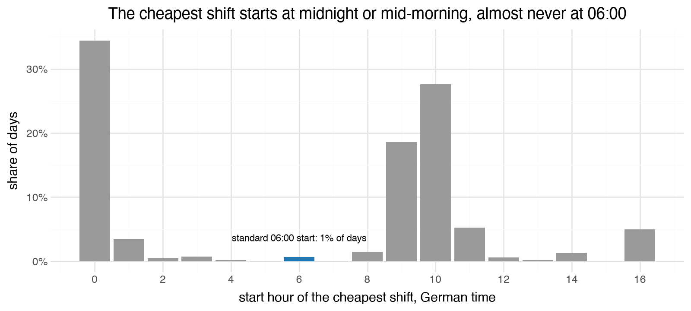
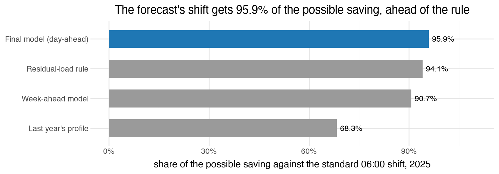
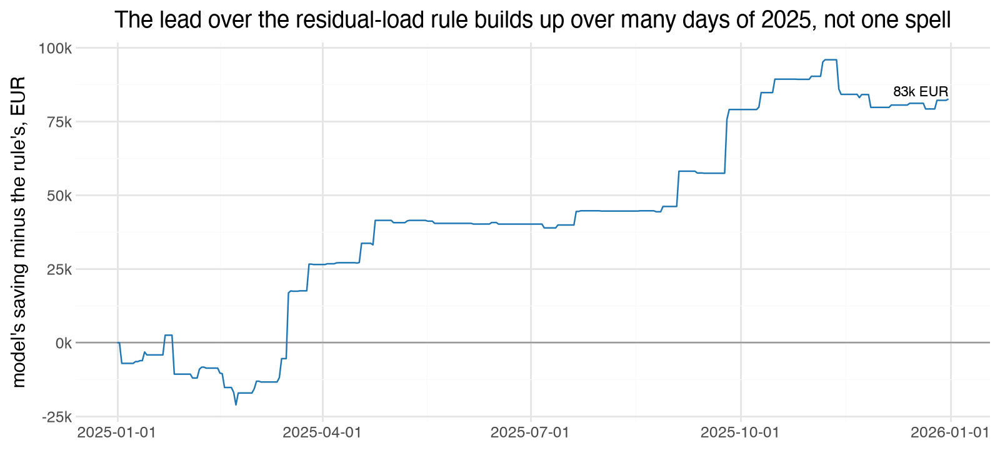
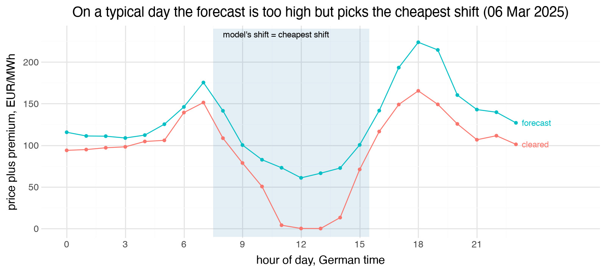
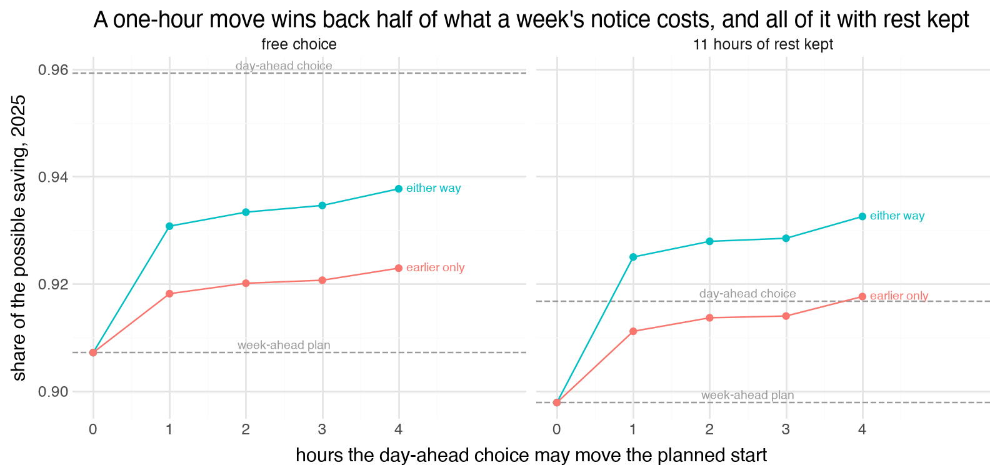

# 1. The business problem

A German manufacturer runs one 8-hour shift a day and buys 500 MWh of electricity for it, 62.5 MW in each hour of the shift. It buys that power in the day-ahead auction, which sets a separate price for every hour of tomorrow and closes at 12:00 the day before (ACER n.d.; Nord Pool 2025). So every day at 11:55, five minutes before the auction closes, the plant has to decide when tomorrow's shift starts, at any hour from 00:00 to 16:00. Each hour of the shift costs its day-ahead price, plus a staff premium of 625 EUR an hour at night (22:00 to 06:00) and at weekends, about 25% on a crew costing 2,500 EUR an hour. Spread over 62.5 MWh, the premium adds 10 EUR/MWh.

Prices within a German day are far from flat. Solar power pushes the midday price down, sometimes below zero, and demand lifts it in the morning and evening. A plant that always runs the standard early shift, 06:00 to 14:00, pays whatever those hours cost. In 2025, the cheapest shift in hindsight would have saved 4.47 million EUR against that standard shift. The plant cannot know tomorrow's prices at 11:55, so it needs a forecast.

The simplest forecast-based rule needs no price model at all: run the shift in the eight hours with the lowest forecast residual load (demand minus wind and solar), the demand that coal, gas and imports have to cover. That rule is strong, but it works in gigawatts, so it cannot weigh the 10 EUR/MWh premium against a price gap. A price forecast can.

Our questions:

1. Can a price forecast made at 11:55 pick a cheaper shift than the residual-load rule?
2. How much is that worth to the plant in a year?
3. Does it still pay when the shifts must be fixed a week ahead, as a staff roster needs, and when staff must get 11 hours of rest between shifts, as German law requires (ArbZG §5)?

Answering them needs hourly prices and the forecasts the market sees, over enough years to cover calm and crisis markets. We use seven years of public German data, build the forecast on 2019 to 2024, and test it once on 2025.

**In short:** our final model, a Lasso followed by XGBoost on calendar, load and renewable forecasts and recent prices, picks shifts that capture 95.9% of the possible saving in 2025. That is 4.29 million EUR a year against the standard shift, 83,000 EUR more than the residual-load rule, a lead that held in both validation years and in the first nine months of 2026. Fixing the whole week on Sunday costs about 233,000 EUR a year of that saving. With the legal rest kept, the best plan is a mix: fix each week's shifts on Sunday and let the 11:55 forecast move each start by up to one hour. That saves 4.04 million EUR a year, more than choosing each day freely under the same rule (4.01 million).

# 2. Data, assumptions and what is missing

Everything that follows rests on public data, so first what that data covers and what it leaves out.

| Source | What it gives | Size |
|---|---|---|
| Energy-Charts API, Fraunhofer ISE: DE-LU day-ahead prices | the clearing price of every hour (every quarter hour from 1 Oct 2025) | 95,255 rows, 1 Jan 2019 to 11 Oct 2026 |
| Energy-Charts API: TSO day-ahead forecasts | load, solar, onshore wind, offshore wind for every quarter hour of day D | 272,732 rows, same span |
| Energy-Charts API: neighbouring zones | day-ahead prices of France, the Netherlands, Belgium, Austria, Switzerland, Czechia, Poland, Denmark (2 zones), southern Sweden and southern Norway | 95,255 rows, same span |

Table 1. Data sources (Fraunhofer ISE n.d.).

Four steps turned the files into one hourly table. First, every file is averaged to UTC hours: the forecasts were quarter-hourly from the start, and the prices turned quarter-hourly when the European market moved to 15-minute products on 1 October 2025, so from then on the target is the hourly mean of four quarter-hour prices. Second, calendar columns are set in German local time, because demand follows the local clock; this leaves 8 days with 23 hours and 7 with 25. Third, the only missing values, one day of Dutch prices (10 October 2026), are filled with the last known Dutch price. Fourth, every extreme stays in, including the one hour at the auction floor of -500 EUR/MWh in 2023, because these are real auction results that the plant would have paid. We also build residual load as load minus solar and wind.

The split follows time. Two validation folds train on every year before their validation year, 2023 and 2024, so each choice is tested in a year after the gas crisis and in a calm one. 2025 is the test year, scored once by the final model. 2026 up to 11 October is a reserve, scored once at the end as a bonus check. Exploration used 2019 to 2023, which makes the 2023 fold slightly optimistic; 2024 was never explored.

The gaps in the data and our assumptions, ranked by how much they could move the results:

1. **Forecast timing.** By EU rules the TSOs publish the day-ahead load forecast at least two hours before the auction closes, but the wind and solar forecasts only by 18:00 the day before (Commission Regulation (EU) No 543/2013). So the wind, solar and residual-load inputs we use would not be public at 11:55. A real buyer would buy a commercial forecast made the same morning from the same weather models. We have no access to those, so the TSO forecast stands in for one. The residual-load rule uses the same forecasts, so the timing does not favour either way of choosing the shift.
2. **No fuel price and no holidays.** The data has no gas price, so the price level has to come from recent prices, and public holidays look like ordinary weekdays.
3. **The plant is a price taker.** In 2025's cheaper hours, each extra GW of residual load raised the price by about 2.9 EUR/MWh, so the plant's 62.5 MW raises its own price by about 0.18 EUR/MWh, under 1% of the 23.5 EUR/MWh its chosen shift saves against the standard one. A buyer would need about 3.4 GW, 6% of German demand, to move the price by the size of the premium.
4. **A simplified decision.** A shift stays within one day, though a real one can cross midnight, and the night and weekend premiums do not stack.

# 3. What decides the cheapest shift

Before building a model, we looked at what moves the cheapest shift and how much simple rules already get, using 2019 to 2023.

Figure 1. Share of days on which the cheapest shift, premium included, starts at each hour, 2019 to 2023.

The cheapest shift almost never starts at 06:00 (Figure 1). In each year it started at midnight on 30% to 39% of days, where the night premium is outweighed by low night prices, and at 09:00 or 10:00 on 40% to 57% of days, over the midday solar dip. The standard shift was the cheapest on about 1% of days. So a fixed early shift leaves money on the table almost every day, and the choice is between two very different parts of the day.

Only the shape of the day matters to that choice. Moving every hour of a day up by the same amount makes every shift dearer by the same amount and changes nothing the plant does. Yet most price movement is exactly that: in 2021 and 2022, over 80% of the variance in hourly prices came from whole days moving up and down, as the yearly mean price went from 30 EUR/MWh in 2020 to 235 in 2022. A model that minimises its error over all hours spends most of its effort on the level, which the decision never uses. We therefore judge every model by the cost of the shift it picks.

Residual load sets the shape. Within each day, hours with high residual load are the expensive ones, at a correlation of 0.70 over 2019 to 2023 and between 0.76 and 0.85 in each year. But the price each extra GW adds moved from 1.1 EUR/MWh in 2019 to 7.1 in 2022, with the gas price. The data has no gas price, so a model has to read the level from recent prices: same hour yesterday is the strongest legal lag (correlation 0.90), and same hour a week earlier catches the weekly cycle.

Simple rules already get most of the saving. Picking the hours with the lowest forecast residual load gets 87% to 97% of the possible saving in each year, yesterday's prices 52% to 71%, and last year's average hourly price 26% to 54%. The residual-load rule misses most in the calm years 2019 and 2020, when the 10 EUR/MWh premium is large next to the price gaps between hours and the rule cannot see it. That gap, 3% to 13% of the saving, is the room a price forecast has.

So the method forecasts prices from residual load, recent prices and the calendar, and is judged by the shift it picks.

# 4. Method

Section 3 showed that the choice uses only the shape of the day, so a forecast is judged by the decision it leads to, not by its price error (Elmachtoub and Grigas 2022).

## 4.1 The decision metric

Each method forecasts tomorrow's 24 hourly prices, adds the premium, and picks the 8 consecutive hours with the lowest total. The shift is then paid at the real cleared price. The saving share compares three costs over a year, each the average EUR/MWh of price plus premium:

saving share = (standard shift cost - picked shift cost) / (standard shift cost - cheapest shift cost)

100% means the method always found the cheapest shift; 0% means it did no better than the standard shift. In 2023, for example, the standard shift cost 97.4 EUR/MWh on average, the cheapest shift 74.5 and the residual-load rule's pick 76.2, so the rule got (97.4 - 76.2) / (97.4 - 74.5) = 93% of the possible saving. We also give the saving in EUR a year for 500 MWh a day. Mean absolute error (MAE), root mean squared error (RMSE) and MASE, the MAE over that of same hour yesterday (Hyndman and Koehler 2006), are reported for the course and only break ties.

## 4.2 Three candidate methods

A linear model alone fails here, because the price each GW of residual load adds bends with the price level, and in 2021 the price rose steeply above about 52 GW. We compared three methods:

- **Lasso-then-XGBoost.** A Lasso (Tibshirani 1996) fits the steady daily and weekly pattern, which a linear model handles well, and XGBoost (Chen and Guestrin 2016) then fits what the Lasso got wrong, such as the bend. The forecast is the sum of the two. The Lasso sees residual load and solar instead of all five forecasts, since residual load is an exact combination of the other four.
- **XGBoost alone**, the same method with the Lasso stage switched off, which shows whether the Lasso stage helps.
- **LEAR**, the linear benchmark of Lago et al. (2021): one Lasso per delivery hour on the prices of the last days and the forecasts. We refit it once a year, like the other two; the published version refits daily, which would probably help it.

## 4.3 How each choice is made

Every choice compares two options, A and B, on both validation years. For each year we take the gap, A's score minus B's, and A leads if the mean gap is larger than its standard error, the SD of the two gaps divided by the square root of 2. With two years this means A leads only if it beats B in both. Taking the gap within each year cancels what the two years share: the residual-load rule, LEAR and Lasso-then-XGBoost all score about 2 points higher in 2024 than in 2023. Three rules, fixed before each comparison, settle every choice: between two methods, the one that leads on saving share wins, then the one that leads on MAE, then the simpler one; within one method, the best setting is the lowest MAE among the settings that tie with the top one; and a wider search only replaces a chosen setting if it wins under the first rule.

This rule changed after the presentation. The presentation chose XGBoost alone under an earlier rule that compared the gap in mean saving share with each model's spread across the two years. That spread mostly measured how different 2023 and 2024 are, which moves both models the same way, so we replaced it with the paired gap. Under the paired gap Lasso-then-XGBoost wins. The change cost a little on the test year (95.9% against XGBoost alone's 96.4% in 2025) and gained on the reserve (99.1% against 98.7%). It was made after 2025 had been scored, so the 2026 reserve is the cleaner check of it.

# 5. Choosing the model on 2023 and 2024

We compared the methods first, then the feature groups, then the settings, each on both validation years under the rules above.

## 5.1 Methods

| Method (default settings) | Saving share | 2023, 2024 | MAE (EUR/MWh) | MASE |
|---|---|---|---|---|
| Lasso-then-XGBoost | 95.6% | 94.7%, 96.6% | 17.5 | 0.636 |
| XGBoost alone | 95.4% | 95.6%, 95.1% | 18.9 | 0.686 |
| Residual-load rule | 94.1% | 93.0%, 95.2% | | |
| LEAR | 93.5% | 92.7%, 94.4% | 17.1 | 0.621 |
| Same hour yesterday | 73.7% | | 27.5 | 1.000 |
| Last year's profile | 55.3% | | | |

Table 2. Methods on the validation years, mean of 2023 and 2024.

LEAR prices the hours best, with the lowest MAE of the three methods, yet it gets the smallest share of the saving: both tree methods beat it in both years, by 2.1 and 1.8 points, and so does the residual-load rule (Table 2). Pricing each hour well is not the same as ranking the hours well, and the ranking is what picks the shift. LEAR was not taken further. At default settings the two tree methods tie.

## 5.2 Feature groups

Each group was tested by leaving it out of, or adding it to, the set of the others. Recent prices matter most: without them the saving share falls by 31 points. The load and renewable forecasts add 10.3 points once recent prices are in, and only then; calendar with recent prices reaches 85.5%, and adding the forecasts lifts it to 95.8%. Recent prices give the level the premium is weighed against, and the forecasts give the shape. Calendar ties and stays, because this comparison was run after 2025 had been scored, and removing it would have changed the final model with no untouched year left to test it on. A residual-load-times-level column tied and was dropped as the simpler option. The neighbour price spreads lowered the saving share in both years, even though they cut MAE from 19.1 to 17.5 EUR/MWh, so they were dropped too. The final model has 17 columns: hour, weekday, month and weekend flag; the five forecasts; and eight recent-price columns (the same hour 1, 2 and 7 days earlier, yesterday's mean, minimum and maximum, and the 7-day and 30-day mean).

## 5.3 Settings

Both tree methods then got the same grid of 24 tree settings, and Lasso-then-XGBoost three Lasso penalties on each. At their best, Lasso-then-XGBoost gets 96.7% and XGBoost alone 95.7%, and the two-stage model is ahead in both years (96.3% against 95.5% in 2023, 97.1% against 96.0% in 2024). A random search of 100 more settings for each found nothing that beat these under the rules. The final model is Lasso-then-XGBoost with a Lasso penalty of 3 and 500 trees, 6 levels deep, at a learning rate of 0.03. On the validation years it gets 96.7% of the possible saving, picks the cheapest shift on 74.7% of days, and has an MAE of 17.3 EUR/MWh, against 94.1% for the residual-load rule, a lead of 2.7 points in both years.

## 5.4 Does the model make sense?

The model is weakest where the price spikes. Hours above 200 EUR/MWh are missed by 91 EUR/MWh on average and predicted 56 too low, against 16 for ordinary hours. The worst days are a windless cold spell in December 2024, when it missed by up to 245 EUR/MWh. Its errors grow with the price, so we tried forecasting asinh(price), which compresses large prices. That made the decision worse, 94.5% against 96.7%, because it also compresses the gaps between hours that pick the shift, so the model stays as it is. By hour, the model predicts the evening peak and the night a few EUR/MWh too low and midday about 3 EUR/MWh too high.

# 6. Results on 2025

With every choice made on the validation years, the final model was refitted on 2019 to 2024 and scored once on 2025, a year neither the model nor the exploration had seen.

Figure 2. Share of the possible saving against the standard 06:00 shift, 2025.

| Method, 2025 | Saving share | Saving, EUR a year | Cheapest shift picked | MAE |
|---|---|---|---|---|
| Final model | 95.9% | 4,287,000 | 73.7% of days | 16.2 |
| Residual-load rule | 94.1% | 4,205,000 | 70.7% | |
| Same hour yesterday | 83.2% | 3,717,000 | 49.9% | 26.0 |
| Last year's profile | 68.3% | 3,055,000 | 32.9% | |
| Cheapest shift in hindsight | 100% | 4,469,000 | 100% | |

Table 3. The test year, 2025, for 500 MWh a day.

The forecast beats the rule on the test year (Figure 2, Table 3). It gets 95.9% of the possible saving against 94.1%, 4.29 million EUR a year against the standard shift, 83,000 EUR more than the rule. The lead is smaller than on the validation years (1.8 points against 2.7) but on the same side.

Is 83,000 EUR luck in which days 2025 happened to bring? To check, we resampled the year 10,000 times from runs of 7 consecutive days drawn with replacement, which keeps the weekly cycle and spells of similar weather together (Künsch 1989). The 95% interval for the lead runs from 3,700 to 181,000 EUR a year, and the model does no better than the rule in only 2% of the resampled years. With runs of 1 or 30 days the answer is the same. So the lead is unlikely to be luck, but its size is uncertain.

Figure 3. The final model's saving minus the residual-load rule's, added up from 1 January 2025.

The lead builds up over the year rather than coming from a few days (Figure 3). The model trails the rule through February, pulls ahead in March, holds about 40,000 EUR through the summer and ends the year at 83,000.

Figure 4. Forecast and cleared price plus premium on 6 March 2025, the 2025 weekday whose mean price is closest to the year's median day.

On a typical day the forecast can be well off and still pick right (Figure 4). On 6 March 2025 it was 7 to 69 EUR/MWh too high in every hour and missed how deep the midday solar dip went, yet its shift, 08:00 to 16:00, was the cheapest one. This is the point of section 3 in one day: the level was wrong, the shape was right, and the shape is all the decision uses.

The 2026 reserve agrees. Refitted on everything up to 2025 and scored once on 1 January to 11 October 2026, the model gets 99.1% of the possible saving against 97.8% for the rule, about 73,000 EUR a year, with a 95% interval of 20,000 to 157,000.

# 7. Putting it into practice: notice and rest

After the presentation, Dr Lim raised two practical points: staff need their shifts planned more than a day ahead, and consecutive shifts may leave too little rest. He then suggested combining a week-ahead plan with a small adjustment the day before. This section answers each in turn, on the same 2025 test year.

## 7.1 Fixing the week on Sunday

A roster needs more than a day's notice, so we fixed all seven shifts of each week on the Sunday before, at 11:55. The final model and its settings stay the same, but only inputs known that early are allowed: the calendar and prices up to that Sunday. No TSO publishes wind or solar forecasts a week ahead, and the week-ahead load forecast TSOs do publish (a daily maximum and minimum, every Friday) is not in our data source, so the week-ahead model sees no weather at all. It still gets 90.7% of the possible saving on 2025, 4.05 million EUR a year. That is about 233,000 EUR a year less than choosing each day the day before, and a million more than last year's profile, which needs no forecast. On the validation years it gets 86.1%. Its price forecast is worse than same hour yesterday (MASE 1.03), yet it picks well, because the clock and last week's prices carry most of the shape.

## 7.2 Eleven hours of rest

German law requires at least 11 hours of rest between the end of one working day and the start of the next (ArbZG §5). With 8-hour shifts a day apart, that means a shift may start at most 5 hours earlier than the day before's. Choosing each day freely ignores this, so we counted how often each schedule breaks it and what keeping it costs. With the rule kept, each method takes its cheapest forecast shift among the starts that leave 11 hours of rest after yesterday's shift, which matches a choice made at 11:55 when yesterday's shift is fixed. The best possible rest-keeping schedule, found over the whole year by dynamic programming, is the new 100%.

| Schedule, 2025 | Days that break the rule | Saving share, free choice | Saving share, rest kept | Change in saving, EUR a year |
|---|---|---|---|---|
| Final model (day-ahead) | 27 (7.4%) | 95.9% | 91.7% | -279,000 |
| Week-ahead schedule | 12 (3.3%) | 90.7% | 89.8% | -129,000 |
| Residual-load rule | 43 (11.8%) | 94.1% | 85.8% | -453,000 |
| Cheapest in hindsight | 26 (7.1%) | 100% | 100% | -97,000 |

Table 4. Rest between shifts, 2025.

Even the cheapest schedule in hindsight breaks the rule on about one day in 14, so the conflict is real, not a flaw of the forecast (Table 4). Keeping the rule costs the final model 279,000 EUR a year, leaving 4.01 million, and costs the residual-load rule more, 453,000, so with rest kept the model's lead over the rule grows from 83,000 to about 257,000 EUR a year. Choosing one day at a time, a method cannot see that a late shift today rules out a cheap early shift tomorrow, which is why hindsight, planning the whole year, loses only 97,000.

## 7.3 Plan the week, adjust the day before

Dr Lim's suggestion combines the two: fix each day's shift on the Sunday before with the week-ahead model, and at 11:55 the day before let the final model move that day's start, but only within a few hours of the plan. Staff then know their shift a week ahead, and it moves by a few hours at most. We let the start move up to W hours either way, for W from 0 to 4, and in a second version only earlier, by 0 to W hours. With the rest rule kept, the plan itself keeps the rule and the final start must also leave 11 hours after the previous day's final shift; a legal start always exists within the window.

Figure 5. Share of the possible saving against how far the 11:55 choice may move the Sunday plan, 2025, with the pure week-ahead plan and the pure day-ahead choice as dashed lines.

| Reach | Saving share, free | EUR a year, free | Saving share, rest kept | EUR a year, rest kept | Days moved |
|---|---|---|---|---|---|
| None (week-ahead plan) | 90.7% | 4,055,000 | 89.8% | 3,926,000 | 0% |
| 1 hour either way | 93.1% | 4,160,000 | 92.5% | 4,045,000 | 35% |
| 2 hours either way | 93.3% | 4,172,000 | 92.8% | 4,057,000 | 35% |
| 4 hours either way | 93.8% | 4,191,000 | 93.3% | 4,078,000 | 36% |
| 1 hour earlier only | 91.8% | 4,104,000 | 91.1% | 3,984,000 | 13% |
| 4 hours earlier only | 92.3% | 4,125,000 | 91.8% | 4,012,000 | 13% |
| Any start (day-ahead choice) | 95.9% | 4,287,000 | 91.7% | 4,009,000 | |

Table 5. Plan on Sunday, adjust at 11:55 the day before, 2025. Days moved: share of days whose final start differs from the plan, free choice.

Most of the gain comes from the first hour (Figure 5, Table 5). Choosing freely, letting the start move one hour either way lifts the saving share from 90.7% to 93.1%, winning back about 105,000 of the 233,000 EUR a year a week's notice costs. Four hours win back 136,000. The start moves on about a third of days, and by 0.35 hours a day on average at a one-hour reach. Moving only earlier wins back roughly half as much. On the validation years the gain is smaller, 74,000 of a 438,000 EUR gap at one hour.

With the rest rule kept, the plan with an adjustment does better than choosing each day freely the day before: 4.04 million EUR a year at one hour and 4.08 million at four, against 4.01 million on 2025, and 3.56 and 3.61 million against 3.29 million on the validation years. The likely reason is the one in section 7.2. Choosing one day at a time under the rule, a late shift today can rule out a cheap early shift tomorrow; a plan that already keeps the rule holds each day's choice near a sequence that works. Under the law, a week's notice with one hour of room to move costs the plant nothing.

# 8. Recommendations

1. **Choose the shift every day.** A fixed 06:00 shift is the cheapest on about 1% of days. Choosing the shift by forecast residual load alone saved 4.20 million EUR a year against it on 2025, so the choice itself is where most of the money is.
2. **Plan each week on Sunday, and let the 11:55 forecast move each start by up to one hour.** This keeps a week's notice for staff and the legal 11 hours of rest, and on 2025 it saves 4.04 million EUR a year, more than choosing each day freely under the rest rule (4.01 million) and 119,000 more than a fixed weekly plan. A wider window of four hours adds about 33,000 more.
3. **Use the price forecast, not the residual-load rule, for the daily choice.** It saves 83,000 EUR a year more on 2025 with free choice, and about 257,000 more once the rest rule is kept, because it weighs the night and weekend premium in euros.
4. **Buy a commercial wind and solar forecast that is available before 12:00.** The TSO forecasts we used are published after the auction closes, and the results assume a forecast of similar quality bought the same morning.

# 9. Limitations

1. **Forecast timing.** The wind and solar forecasts in our data are published at 18:00 the day before, after the auction closes. All results assume a commercial forecast of similar quality; a follow-up should rerun the test on one.
2. **A small and uncertain lead.** The lead over the residual-load rule rests on two validation years, one test year and nine months of reserve. Within 2025 it is unlikely to be luck, but its size runs from almost nothing to 181,000 EUR a year. More years, scored with a rolling refit, would narrow it.
3. **Spikes.** Hours above 200 EUR/MWh are missed by about 91 EUR/MWh. Scarcity features, such as how close residual load is to available capacity, would be the next thing to try.
4. **A simplified decision.** Shifts stay within one day, premiums do not stack, and the plant is a price taker. Shifts that cross midnight would add the night hours the plant now cannot choose.
5. **No fuel price and no holidays.** The level comes from recent prices alone. A gas price series and a holiday calendar are the inputs most likely to improve the level and the holiday shape.
6. **Choices made after the test.** The selection rule changed, and the calendar decision was taken, after 2025 had been scored. The 2026 reserve, scored once with nothing changed after it, is the clean check, and it agrees.
7. **LEAR refitted yearly.** The published benchmark refits daily, so our comparison likely understates it.

# References

ACER (n.d.) REMIT reporting guidance, question 2.1.29. Available at: https://www.acer.europa.eu/question-2129-data-field-30

Arbeitszeitgesetz (ArbZG), §5 Ruhezeit. Available at: https://www.gesetze-im-internet.de/arbzg/__5.html

Chen, T. and Guestrin, C. (2016) 'XGBoost: A scalable tree boosting system', Proceedings of the 22nd ACM SIGKDD International Conference on Knowledge Discovery and Data Mining, pp. 785-794. https://doi.org/10.1145/2939672.2939785

Commission Regulation (EU) No 543/2013 of 14 June 2013 on submission and publication of data in electricity markets, Articles 6 and 14. Available at: https://eur-lex.europa.eu/eli/reg/2013/543

Elmachtoub, A. N. and Grigas, P. (2022) 'Smart "predict, then optimize"', Management Science, 68(1), pp. 9-26. https://doi.org/10.1287/mnsc.2020.3922

Fraunhofer ISE (n.d.) Energy-Charts API. Available at: https://api.energy-charts.info

Hyndman, R. J. and Koehler, A. B. (2006) 'Another look at measures of forecast accuracy', International Journal of Forecasting, 22(4), pp. 679-688. https://doi.org/10.1016/j.ijforecast.2006.03.001

Künsch, H. R. (1989) 'The jackknife and the bootstrap for general stationary observations', The Annals of Statistics, 17(3), pp. 1217-1241. https://doi.org/10.1214/aos/1176347265

Lago, J., Marcjasz, G., De Schutter, B. and Weron, R. (2021) 'Forecasting day-ahead electricity prices: A review of state-of-the-art algorithms, best practices and an open-access benchmark', Applied Energy, 293, 116983. https://doi.org/10.1016/j.apenergy.2021.116983

Nord Pool (2025) SDAC 15-minute MTU go-live. Available at: https://support.nordpoolgroup.com/support/solutions/articles/8000121859-about-sdac-15-minute-member-test

Tibshirani, R. (1996) 'Regression shrinkage and selection via the lasso', Journal of the Royal Statistical Society: Series B (Methodological), 58(1), pp. 267-288. https://doi.org/10.1111/j.2517-6161.1996.tb02080.x
